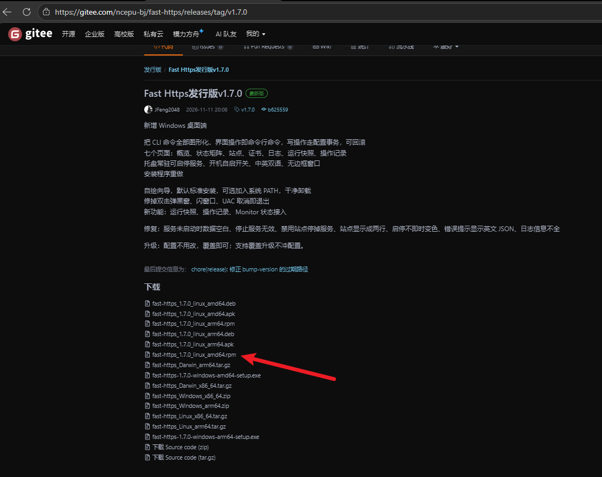
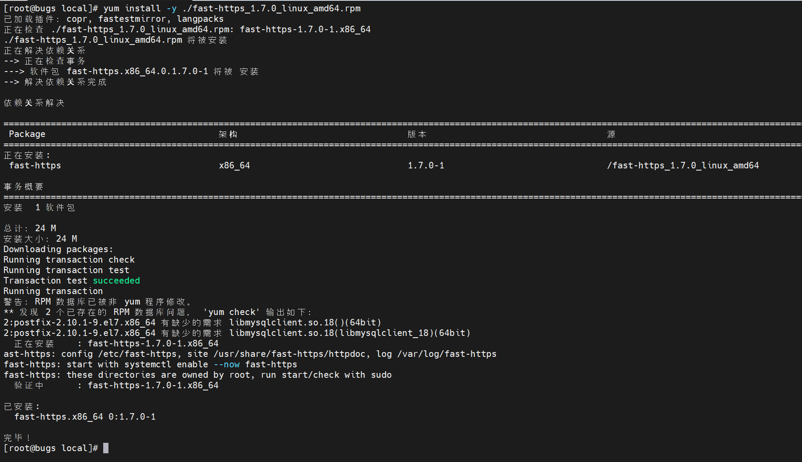
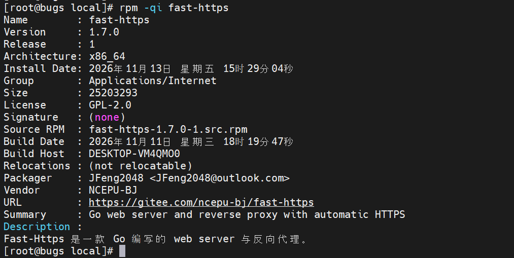
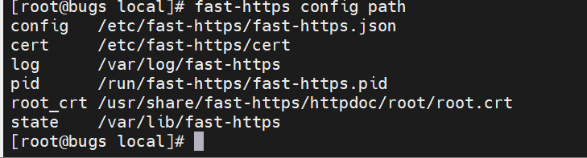
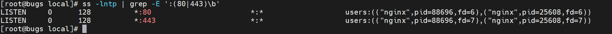
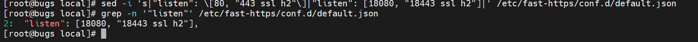
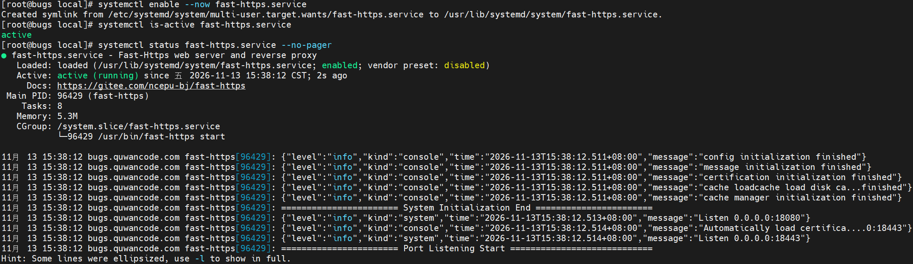
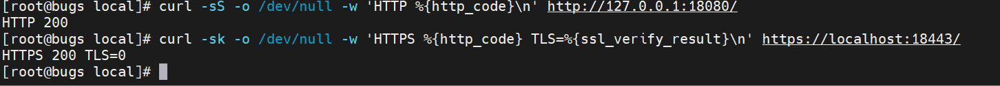

# CentOS 7 installation and deployment

This guide deploys Fast-Https on CentOS and other `yum`-based distributions from an `.rpm` package. Installation registers a system service with start-on-boot and automatic restart. For other methods, see [Install on Ubuntu](../ubuntu/) and [Archive deployment](../unpack-and-deploy/).

## Before you start

- Run every command **in the server's terminal** with administrative rights. Log in as `root`, or prefix each command with `sudo`.
- The default site uses **ports 80 and 443**. On a cloud server, allow both in the console first and make sure no other program occupies them.
- Download the package from [Gitee Releases](https://gitee.com/ncepu-bj/fast-https/releases) or [GitHub Releases](https://github.com/ncepu-iDealStudio/Fast-Https/releases). No version number is hardcoded in this guide: pick the newest release on that page yourself, so the instructions do not go stale after a new release.

**About the "Expected output" blocks**: every output below comes from one complete run. On that machine port 80 was already used by another site, so `listen` was changed to `18080` / `18443` as described in step 3, and the verification URLs use those ports too. If your ports 80 / 443 are free, substitute the defaults — the shape of the output is identical.

## 1 Check the architecture and download the package

`.rpm` is the package format used by CentOS and the RHEL family. Different processors need different packages, so check yours first:

```bash
# Show the processor architecture
uname -m
```

**Expected output**

```text
x86_64
```

`x86_64` maps to the `amd64` package; `aarch64` maps to `arm64`.

**Get the download link from the releases page yourself** — no version number is hardcoded here, so a new release cannot turn this into a stale link:



The arrow marks the `amd64` package; on `aarch64`, pick the one ending in `arm64` instead. Use whatever version the topmost release offers.

1. Open [Gitee Releases](https://gitee.com/ncepu-bj/fast-https/releases) or [GitHub Releases](https://github.com/ncepu-iDealStudio/Fast-Https/releases) in a browser, find the **topmost** release and expand its asset list.
2. Pick the **server** `.rpm` asset for your architecture: `x86_64` needs a filename containing `amd64`, `aarch64` needs `arm64`. Do not pick the `fast-https-desktop` desktop edition.
3. **Right-click the download button → copy link address**.
4. Back in the server terminal, replace the address inside the quotes with the link you copied, then run:

```bash
# Download the package and give it a fixed name
wget -O fast-https.rpm 'paste the copied download link here'
# Confirm the package downloaded and its size
ls -lh fast-https.rpm
```

`-O fast-https.rpm` gives the downloaded file one fixed name, which every later command uses — **you never need to edit a version number anywhere in this guide**. Keep the single quotes; the link may contain special characters.

**Expected output** (`wget`'s progress output is omitted; only the `ls` line is shown)

```text
-rw-r--r-- 1 root root 6.5M Nov 10 19:52 fast-https.rpm
```

Seeing the filename and size means the download worked. If you prefer downloading on your own computer, upload the package with `scp` or an FTP tool into the current directory and rename it to `fast-https.rpm`; the result is the same.

## 2 Install

```bash
# Install the .rpm package
yum install -y ./fast-https.rpm
# Show details of the installed package
rpm -qi fast-https
```

`-y` answers installation prompts automatically and `./` means "this file in the current directory". `yum` resolves the `ca-certificates` and `logrotate` dependencies.

**Expected output** (tail of `yum`)

```text
Running transaction
fast-https: config /etc/fast-https, site /usr/share/fast-https/httpdoc, log /var/log/fast-https
fast-https: start with systemctl enable --now fast-https
fast-https: these directories are owned by root, run start/check with sudo
  Verifying  : fast-https-1.6.0-1.x86_64                                    1/1

Installed:
  fast-https.x86_64 0:1.6.0-1

Complete!
```



The screenshot uses the original filename from the releases page; with the `-O` rename above, the output looks the same.

`Complete!` marks the end of the installation; the three `fast-https:` lines are paths and a start hint printed by the install script. The beginning of `rpm -qi` looks like this:

```text
Name        : fast-https
Version     : 1.6.0
Release     : 1
Architecture: x86_64
Group       : Applications/Internet
Size        : 17292444
License     : GPL-2.0
```



The version number shown here is just the package used during the test run; yours will differ if you downloaded a newer release.

Installed file locations (you will need these when editing configuration or reading logs):

| Purpose | Path |
| --- | --- |
| Binary | `/usr/bin/fast-https` |
| Main configuration | `/etc/fast-https/fast-https.json` |
| Site configuration | `/etc/fast-https/conf.d/default.json` |
| Default site root | `/usr/share/fast-https/httpdoc/root/` |
| Certificates | `/etc/fast-https/cert/` |
| Logs | `/var/log/fast-https/` |
| pid file | `/run/fast-https/fast-https.pid` |
| systemd unit | `/usr/lib/systemd/system/fast-https.service` |

The pid file records the process ID; the systemd unit is the service's configuration text. Print the resolved locations at any time with:

```bash
# Show the config paths the program uses
fast-https config path
```

**Expected output**

```text
config /etc/fast-https/fast-https.json
cert   /etc/fast-https/cert
log    /var/log/fast-https
pid    /run/fast-https/fast-https.pid
```



Newer releases also print `root_crt` and `state`, which are additional paths; the number of lines may differ between versions.

## 3 Start and enable at boot

First check whether ports 80 / 443 are in use:

```bash
# Check whether ports 80/443 are in use
ss -lntp | grep -E ':(80|443)\b'
```

**Expected output (when a port is occupied)**

```text
LISTEN     0      511          *:80    *:*    users:(("nginx",pid=7677,fd=8),...)
LISTEN     0      511       [::]:80 [::]:*   users:(("nginx",pid=7677,fd=9),...)
```



No output means the ports are free; a process name such as `nginx` means the port is taken. Do not stop someone else's service — change your own configuration instead: edit `/etc/fast-https/conf.d/default.json` and change `listen` from `[80, "443 ssl h2"]` to free ports, for example:

```bash
# Change the default ports to 18080/18443
sed -i 's|"listen": \[80, "443 ssl h2"\]|"listen": [18080, "18443 ssl h2"]|' /etc/fast-https/conf.d/default.json
# Confirm the port change took effect
grep -n '"listen"' /etc/fast-https/conf.d/default.json
```

**Expected output**

```text
2:  "listen": [18080, "18443 ssl h2"],
```



Use these ports in every verification URL below. If the ports were free, skip this part and keep 80 / 443.

The package registers a **systemd service** named `fast-https.service`. systemd is the component that manages background services on Linux; `systemctl` is the command used to control it.

```bash
# Start and enable at boot
systemctl enable --now fast-https.service
# Check whether the service is running
systemctl is-active fast-https.service
# Inspect the service status
systemctl status fast-https.service --no-pager
```

**Expected output**

```text
Created symlink from /etc/systemd/system/multi-user.target.wants/fast-https.service to /usr/lib/systemd/system/fast-https.service.
active
● fast-https.service - Fast-Https web server and reverse proxy
   Loaded: loaded (/usr/lib/systemd/system/fast-https.service; enabled; vendor preset: disabled)
   Active: active (running)
 Main PID: 8395 (fast-https)
   CGroup: /system.slice/fast-https.service
           └─8395 /usr/bin/fast-https start
```



`Created symlink` means start-at-boot is enabled; `active` means the service is running; `Main PID` is the process ID and differs on every start.

The unit already sets `Restart=on-failure` (restart after a crash), `RestartSec=2s` and `ExecReload=/usr/bin/fast-https reload`, so none of that needs manual configuration.

## 4 Verify the default site

```bash
# Verify HTTP returns 200
curl -sS -o /dev/null -w 'HTTP %{http_code}\n' http://127.0.0.1:18080/
# Verify HTTPS (skip self-signed cert validation)
curl -sk -o /dev/null -w 'HTTPS %{http_code} TLS=%{ssl_verify_result}\n' https://localhost:18443/
```

**Expected output**

```text
HTTP 200
HTTPS 200 TLS=0
```



`200` is the status code for a successful request; `-k` skips verification of the self-signed certificate and `TLS=0` indicates the TLS connection itself is healthy. With free ports, use `http://127.0.0.1/` and `https://localhost/` instead.

Confirm the listeners:

```bash
# Show the ports the service listens on
ss -lntp | grep -E ':(18080|18443)\b'
```

**Expected output**

```text
LISTEN   0   4096   [::]:18443   [::]:*   users:(("fast-https",pid=8395,fd=12))
LISTEN   0   4096   [::]:18080   [::]:*   users:(("fast-https",pid=8395,fd=11))
```

Service logs are available with `journalctl -u fast-https.service -n 30 --no-pager`, and include an access record like:

```text
{"level":"info","kind":"access","remote_addr":"127.0.0.1:51554","type":"LOCAL","method":"GET","path":"/","host":"127.0.0.1:18080","status":200,"size":2106,"user_agent":"curl/7.29.0"}
```

`"status":200` matches the curl result, confirming the request reached Fast-Https. Structured logs are also written under `/var/log/fast-https/`.

On a cloud server, open `http://<server public IP>:18080/` in a browser on your own computer (omit the port when using the defaults); `localhost` refers to the server itself and will not work from your computer. A browser warning about an untrusted certificate is expected for a self-signed certificate; use a certificate matching your domain for a public service.

## 5 Manage the service

The package registers `fast-https.service`, so use `systemctl` for day-to-day management:

```bash
# Start the service
systemctl start fast-https.service
# Start and enable at boot
systemctl enable --now fast-https.service
# Check whether the service is running
systemctl is-active fast-https.service
# Inspect the service status
systemctl status fast-https.service --no-pager
# Restart after a config change
systemctl restart fast-https.service
# Reapply the configuration
fast-https reload
# Read recent service logs
journalctl -u fast-https.service -n 30 --no-pager
# Stop and disable start at boot
systemctl disable --now fast-https.service
```

`fast-https reload` and `systemctl restart` print **nothing** on success; verify with `systemctl is-active fast-https.service`, which prints `active`. `disable --now` prints:

```text
Removed symlink /etc/systemd/system/multi-user.target.wants/fast-https.service.
```

After that, `is-active` returns `unknown` (or `inactive`) — both mean the service is stopped.

To remove the package:

```bash
# Remove the package
yum remove -y fast-https
```

**Expected output** (tail)

```text
  Erasing    : fast-https-1.6.0-1.x86_64                                    1/1
warning: /etc/fast-https/conf.d/default.json saved as /etc/fast-https/conf.d/default.json.rpmsave
fast-https: purged config, certs and logs under /etc/fast-https and /var/log/fast-https

Removed:
  fast-https.x86_64 0:1.6.0-1

Complete!
```

A modified configuration file is kept as `.rpmsave` rather than silently discarded.

## 6 Troubleshooting

| Symptom | What to do |
| --- | --- |
| Download returns 404 | The copied link is wrong or points to an old release; go back to the releases page and copy the matching asset link from the topmost release again |
| `yum` cannot find the file | Confirm you are in the directory with `fast-https.rpm`, and that `./` is present |
| The port check lists nginx or another process | Follow step 3 and change `listen`; do not stop someone else's service |
| `is-active` does not print `active` | Run `systemctl status fast-https.service --no-pager` and check the logs |
| curl returns 000 or connection refused | The service is not running, or the verification URL still uses the old port |
| The page will not open on your computer | Check that the port is allowed in the cloud security group, and use the server's public IP |

## Next steps

For a public deployment, set `server_name` to the hostname or IP clients will use. To publish your own site or configure a reverse proxy, see the Tutorials section in the sidebar.
