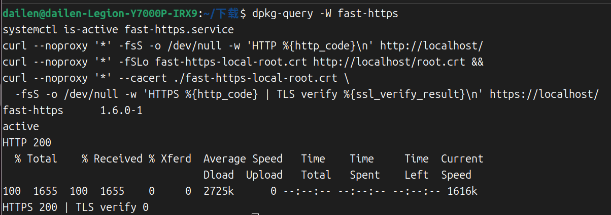
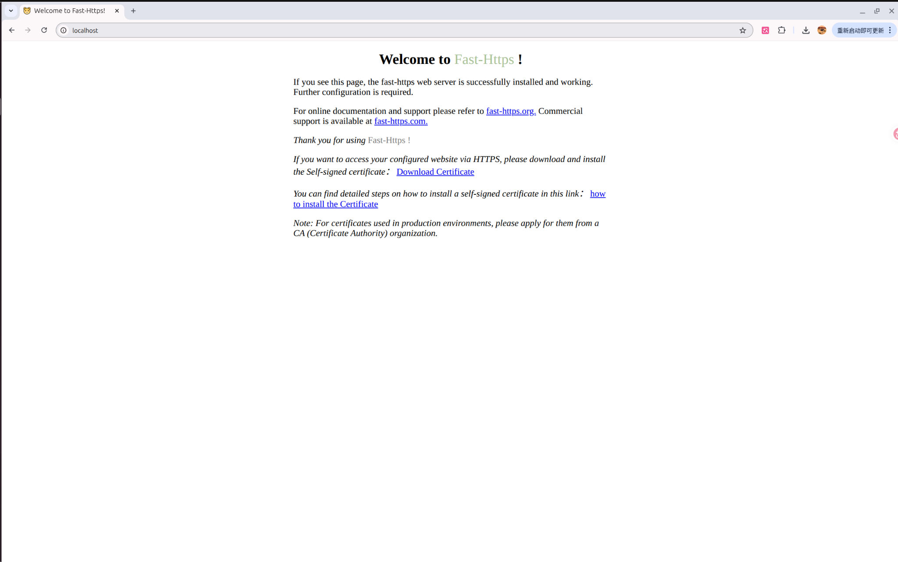

# Install on Ubuntu

This guide deploys Fast-Https on Ubuntu from a `.deb` package. `.deb` is the package format used by Ubuntu and Debian; installing it with `apt` registers a system service that can start automatically at boot.

## Before you start

- Run every command **in the server's terminal**.
- You need an account with `sudo` privileges. `sudo` runs a single command with administrative rights and may ask for your password.
- The default site uses **ports 80 and 443**. On a cloud server, allow both in the console first and make sure no other program (such as Nginx) occupies them — step 3 shows how to check.
- Download the package from [Gitee Releases](https://gitee.com/ncepu-bj/fast-https/releases) or [GitHub Releases](https://github.com/ncepu-iDealStudio/Fast-Https/releases). No version number is hardcoded in this guide: pick the newest release on that page yourself, so the instructions do not go stale after a new release.

## 1 Check the architecture and download the package

Different processors need different packages. Check yours:

```bash
# Show the system architecture
dpkg --print-architecture
```

- `amd64` → download the package whose filename contains `amd64` (most cloud servers)
- `arm64` → download the package whose filename contains `arm64`

**Get the download link from the releases page yourself** — no version number is hardcoded here, so a new release cannot turn this into a stale link:

1. Open [Gitee Releases](https://gitee.com/ncepu-bj/fast-https/releases) or [GitHub Releases](https://github.com/ncepu-iDealStudio/Fast-Https/releases) in a browser, find the **topmost** release and expand its asset list.
2. Pick the **server** `.deb` asset for your architecture: `amd64` needs a filename containing `linux_amd64.deb`, `arm64` needs `linux_arm64.deb`. Files starting with `fast-https-desktop` are the graphical desktop edition, not needed on a server.
3. **Right-click the download button → copy link address**.
4. Back in the server terminal, replace the address inside the quotes with the link you copied, then run:

```bash
# Download the package and give it a fixed name
wget -O fast-https.deb 'paste the copied download link here'
# Confirm the package downloaded and its size
ls -lh fast-https.deb
```

`-O fast-https.deb` gives the file one fixed name, which the install command below uses — **you never need to edit a version number anywhere in this guide**. Keep the single quotes. Seeing the file and its size means the download worked; if you prefer downloading on your own computer, upload it with `scp` or an FTP tool and rename it to `fast-https.deb`.

| Architecture | Filename contains | Where to download |
| --- | --- | --- |
| `amd64` | `linux_amd64.deb` | [Gitee Releases](https://gitee.com/ncepu-bj/fast-https/releases) / [GitHub Releases](https://github.com/ncepu-iDealStudio/Fast-Https/releases) |
| `arm64` | `linux_arm64.deb` | Same as above |

## 2 Install

Go to the directory containing the downloaded package and run the commands below. The `./` prefix means "this file in the current directory" and must not be omitted:

```bash
# Install the .deb package
sudo apt install ./fast-https.deb
# Confirm the installed package name and version
dpkg-query -W fast-https
```

The `./` prefix means "this file in the current directory" and must not be omitted. Because the download already gave the file a fixed name, both `amd64` and `arm64` use this one command. `dpkg-query` prints the package name and version; seeing `fast-https` means the installation succeeded.

Installed file locations (you will need these when editing configuration or reading logs):

| Purpose | Installation path |
| --- | --- |
| Binary | `/usr/bin/fast-https` |
| Main configuration | `/etc/fast-https/fast-https.json` |
| Default site configuration | `/etc/fast-https/conf.d/default.json` |
| Default site root | `/usr/share/fast-https/httpdoc/root/` |
| Certificates | `/etc/fast-https/cert/` |
| Logs | `/var/log/fast-https/` |

## 3 Start the service

First check whether ports 80 / 443 are already in use:

```bash
# Check whether ports 80/443 are in use
ss -ltn '( sport = :80 or sport = :443 )'
```

If only the header line (`State Recv-Q ...`) appears, the ports are free. If a process is listed, edit `/etc/fast-https/conf.d/default.json` and set `listen` to free ports, for example `[18080, "18443 ssl h2"]`, then use those ports in the verification commands too.

The package registers a **systemd service** named `fast-https.service`. systemd is the component that manages background services on Linux; `systemctl` is the command used to control it.

```bash
# Start the service
sudo systemctl start fast-https.service
# Check whether the service is running
systemctl is-active fast-https.service
```

The second command should print `active`, which means the service is running.

## 4 Verify the default site

Test HTTP first:

```bash
# Verify HTTP returns 200
curl --noproxy '*' -fsS -o /dev/null -w 'HTTP %{http_code}\n' http://localhost/
```

`HTTP 200` means success. `200` is the status code for a successful request; `--noproxy '*'` bypasses any proxy configured on the machine so it cannot interfere with this local request.

On the first start, Fast-Https generates a certificate for `localhost` signed by a local CA. Download that CA certificate, then use it to verify the HTTPS connection:

```bash
# Download the self-signed root CA and verify HTTPS with it
curl --noproxy '*' -fSLo fast-https-local-root.crt http://localhost/root.crt &&
curl --noproxy '*' --cacert ./fast-https-local-root.crt \
  -fsS -o /dev/null -w 'HTTPS %{http_code} | TLS verify %{ssl_verify_result}\n' https://localhost/
```

`HTTPS 200 | TLS verify 0` means HTTPS works and certificate verification passed (`0`).



If the server is in front of you with a desktop, open `http://localhost/` in its browser to see the default homepage. **If the server is in the cloud**, open `http://<server public IP>/` in a browser on your own computer instead — `localhost` always means the machine you are currently working on.



A browser will warn that the certificate is not trusted when you open HTTPS. That is expected for a self-signed certificate; for a public service, install a certificate matching your domain.

## 5 Manage the service

The package registers `fast-https.service`, so use `systemctl` for day-to-day management:

```bash
# Start now and enable at boot
sudo systemctl enable --now fast-https.service
# Restart after a config change
sudo systemctl restart fast-https.service
# Inspect the service status
systemctl status fast-https.service --no-pager
# Read recent service logs
sudo journalctl -u fast-https.service -n 30 --no-pager
```

For a local test you can stop the service after verification; `disable --now` also disables startup at boot:

```bash
# Stop the service
sudo systemctl stop fast-https.service
# Stop and disable start at boot
sudo systemctl disable --now fast-https.service
```

To remove the package while keeping configuration, certificates and logs:

```bash
# Remove the package
sudo apt remove fast-https
```

## 6 Troubleshooting

| Symptom | What to do |
| --- | --- |
| Download returns 404 | The copied link is wrong or points to an old release; go back to the releases page and copy the matching asset link from the topmost release again |
| `apt` cannot find the file | Confirm you are in the directory with the package, and that `./` and the filename are correct |
| `is-active` does not print `active` | Run `systemctl status fast-https.service --no-pager` for the error, then check the logs |
| curl returns 000 or connection refused | The service is not running — go back to step 3; if you changed ports, update the verification URLs too |
| The page will not open on your computer | Check that port 80 is allowed in the cloud security group, and use the server's public IP rather than `localhost` |

For a public deployment, set `server_name` to the hostname or IP clients will use and allow the required ports in the firewall and cloud security group.

## Next steps

The default site only confirms the installation. To publish your own site or configure a reverse proxy, see the Tutorials section in the sidebar.
