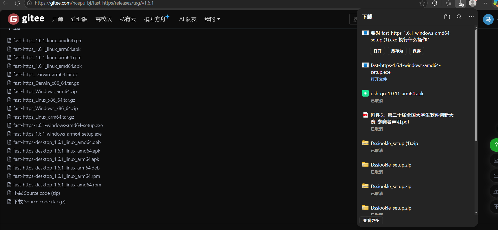
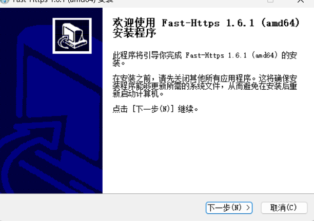
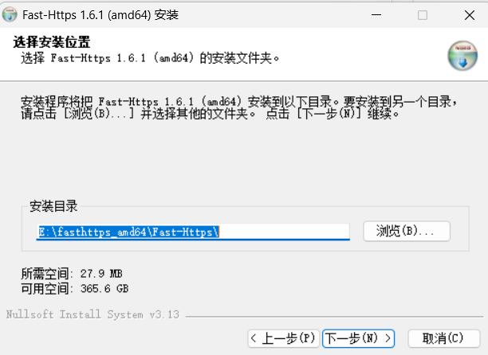
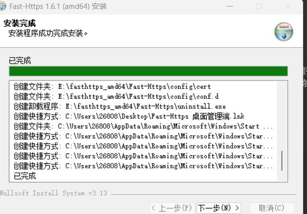
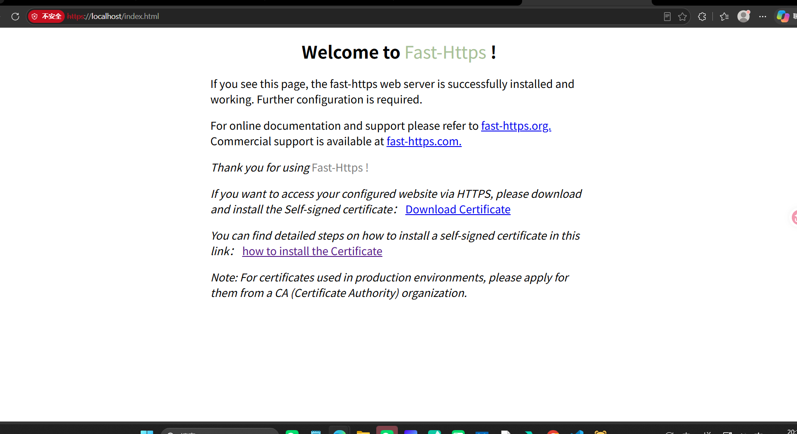

# Installer

Download the Windows installer (`.exe`) from the release page, run it and follow the wizard. Compared with the zip package, the installer writes the program into a chosen folder, creates shortcuts, is removed through Windows "Apps & features", and ships the graphical desktop client.

## 1 Download the installer

Find it in the v1.6.1 assets on the [release page](https://gitee.com/ncepu-bj/fast-https/releases) and download it:

```text
fast-https-1.6.1-windows-amd64-setup.exe      # x64
fast-https-1.6.1-windows-arm64-setup.exe      # ARM64
```

Match on `fast-https-<version>-windows-<arch>-setup.exe`. The same page also offers `fast-https_Windows_x86_64.zip` if you prefer the portable build.



<div class="admon">
<svg viewBox="0 0 24 24" fill="none" stroke="currentColor" stroke-width="2"><circle cx="12" cy="12" r="9"/><path d="M12 8v5M12 16h.01"/></svg>
<div>A browser warning such as "this file isn't commonly downloaded" is <b>expected</b>: the build is not code-signed. Choose «…» → <i>Keep</i> in the download panel, and <i>Keep anyway</i> if prompted again. This is a heuristic browser warning, not a problem with the package.</div>
</div>

## 2 Run the wizard

Double-click the downloaded `setup.exe`. Accept the UAC prompt if Windows shows one.



## 3 Choose the install folder

The default is `E:\fasthttps_amd64\Fast-Https\`, requiring about 30 MB. Use «Browse» to change it; a path without spaces or non-ASCII characters is recommended.



## 4 Finish the installation

Wait for the files to be written, then click «Next» to close the wizard.



The installer creates a `Fast-Https 桌面管理端` desktop shortcut, a Start-menu entry, and `uninstall.exe`.

## 5 Start and verify

Launch **Fast-Https 桌面管理端** from the Start menu or the desktop shortcut; a tray icon appears in the notification area.

Visit in a browser:

```text
http://localhost/
```

The `Welcome to Fast-Https !` page means the installation succeeded.



<div class="admon">
<svg viewBox="0 0 24 24" fill="none" stroke="currentColor" stroke-width="2"><circle cx="12" cy="12" r="9"/><path d="M12 8v5M12 16h.01"/></svg>
<div>The default ports are <b>80 and 443</b>. Use <code>http://localhost/</code> or <code>https://localhost/</code> — <b>do not append <code>:8080</code></b>. The <code>https://localhost:8080/index.html</code> in older docs is the wrong port and results in "This site can't be reached".</div>
</div>

<div class="admon">
<svg viewBox="0 0 24 24" fill="none" stroke="currentColor" stroke-width="2"><circle cx="12" cy="12" r="9"/><path d="M12 8v5M12 16h.01"/></svg>
<div>The screenshot above is <code>https://localhost/index.html</code>: 443 uses a self-signed certificate generated on first start, so the browser shows "Not secure" — choose <i>Advanced → Proceed</i>. <code>http://localhost/</code> shows no such warning. If ports 80/443 are already taken, edit <code>listen</code> in <code>config/conf.d/default.json</code> under the install folder and include the port in the URL.</div>
</div>
