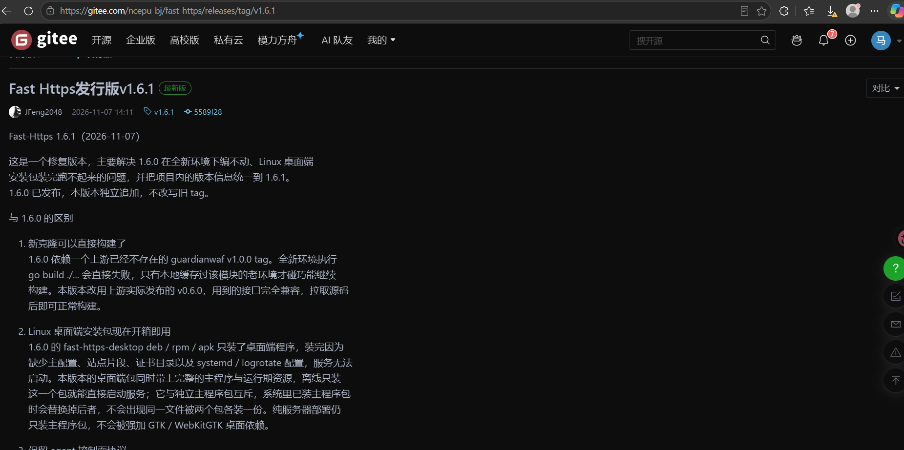
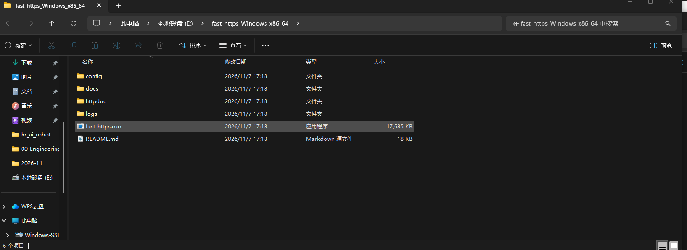
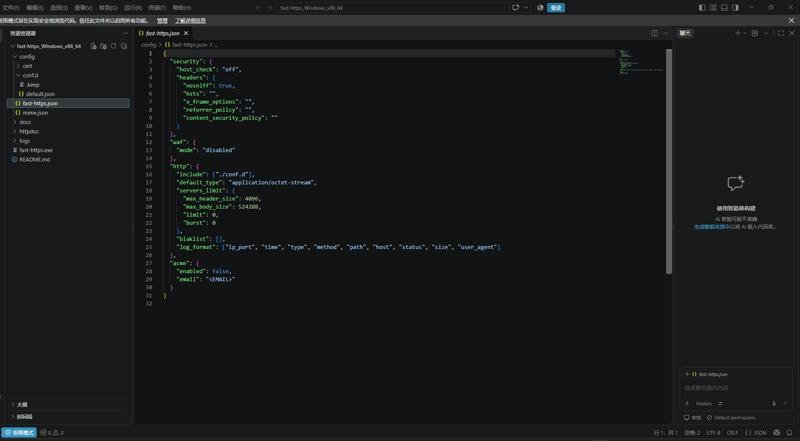
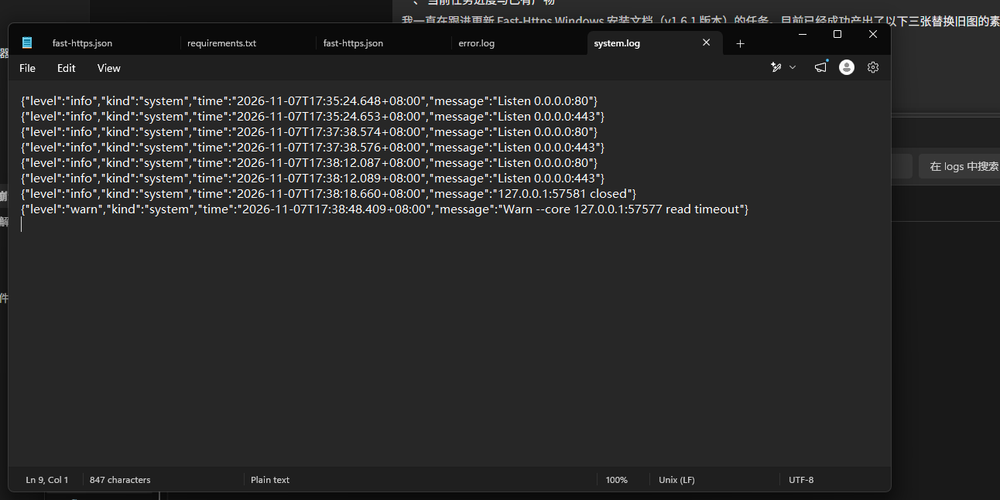
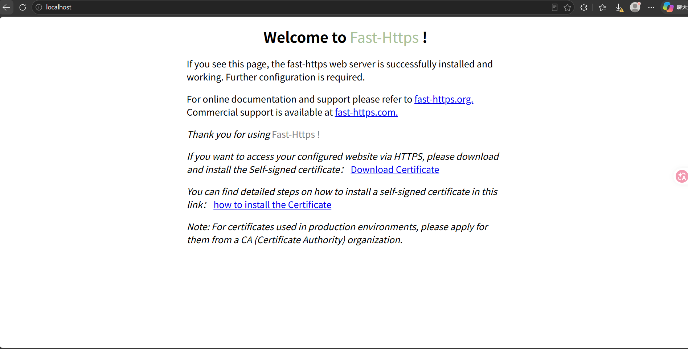
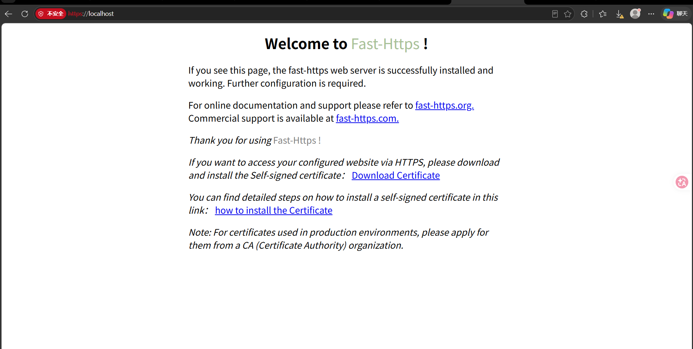

# Zip package

For the portable `fast-https_Windows_x86_64.zip`: extract and run. There is no installer, and deleting the folder removes the program.

Download `fast-https_Windows_x86_64.zip` from the [release page](https://gitee.com/ncepu-bj/fast-https/releases):



## 1 Unzip the package

Extract it into any folder; a path without spaces or non-ASCII characters is recommended, e.g. `E:\fast-https_Windows_x86_64`.



<div class="admon">
<svg viewBox="0 0 24 24" fill="none" stroke="currentColor" stroke-width="2"><circle cx="12" cy="12" r="9"/><path d="M12 8v5M12 16h.01"/></svg>
<div>v1.6.1 <b>no longer ships <code>monitor.exe</code></b>, so older instructions telling you to double-click it are obsolete. The directory contains four folders (<code>config</code>, <code>docs</code>, <code>httpdoc</code>, <code>logs</code>) and two files (<code>fast-https.exe</code>, <code>README.md</code>). Start it as shown in step 3. The zip has no GUI — use the <a href="../installer/">installer</a> if you want the desktop client.</div>
</div>

## 2 Edit the default configuration

In v1.6.1 the configuration has two layers: `config/fast-https.json` holds system-level settings only (log directory, `include`, WAF, ACME), while sites live in `config/conf.d/`, one file per site. It works out of the box, so editing is usually unnecessary.

Edit `config/fast-https.json` with any text editor when you need changes:



The default site `config/conf.d/default.json` listens on both 80 and 443 and serves `./httpdoc/root`:

```json
{
  "listen": [80, "443 ssl h2"],
  "server_name": "localhost",
  "ssl_certificate": "./cert/localhost.pem",
  "ssl_certificate_key": "./cert/localhost-key.pem",
  "location": [
    {
      "url": "/",
      "type": "local",
      "root": "./httpdoc/root",
      "index": ["index.html", "index.htm"]
    }
  ]
}
```

<div class="admon">
<svg viewBox="0 0 24 24" fill="none" stroke="currentColor" stroke-width="2"><circle cx="12" cy="12" r="9"/><path d="M12 8v5M12 16h.01"/></svg>
<div>No certificate preparation is needed: the first <code>start</code> generates a self-signed certificate into <code>config/cert/</code>. If ports 80/443 are already taken, change <code>listen</code> to high ports (e.g. <code>[8080, "8443 ssl h2"]</code>) and include the port in the URL.</div>
</div>

## 3 Start the server

Type `cmd` in the Explorer address bar to open a command prompt in the extracted directory, then run:

```bat
.\fast-https.exe start
```

A successful start prints the ASCII banner and the initialization log, ending with:

```text
======================= Port Listening Start ============================
```



<div class="admon">
<svg viewBox="0 0 24 24" fill="none" stroke="currentColor" stroke-width="2"><circle cx="12" cy="12" r="9"/><path d="M12 8v5M12 16h.01"/></svg>
<div><code>start</code> runs in the <b>foreground</b>: the prompt does not return while the server is up, and a frozen-looking window is normal — it means the service is running. <b>Do not close it</b>; closing the window stops the service. Use <code>Ctrl+C</code>, or run <code>fast-https.exe stop</code> in another window, to stop.</div>
</div>

If you already closed the window, or you are not sure whether the server came up, check either:

- `logs/system.log` — this line means the listener is up: `{"level":"info","kind":"system","message":"Listen 0.0.0.0:80"}`
- `.\fast-https.exe status` — `fast-https is running, pid <n>` means it is up

<div class="admon">
<svg viewBox="0 0 24 24" fill="none" stroke="currentColor" stroke-width="2"><circle cx="12" cy="12" r="9"/><path d="M12 8v5M12 16h.01"/></svg>
<div>A silent terminal, or a window that closes instantly, <b>does not mean the server crashed</b>. Run <code>status</code> first, then check <code>logs/error.log</code> — an empty file means no startup error occurred.</div>
</div>

## 4 Verify the installation

Open a browser:

- `http://localhost/` — the `Welcome to Fast-Https !` page means HTTP works.

  

- `https://localhost/` — the browser reports an untrusted certificate, because 443 uses the self-signed certificate generated on first start. Choose *Advanced → Proceed to localhost*.

  

<div class="admon">
<svg viewBox="0 0 24 24" fill="none" stroke="currentColor" stroke-width="2"><circle cx="12" cy="12" r="9"/><path d="M12 8v5M12 16h.01"/></svg>
<div>For a publicly trusted certificate, run <code>fast-https.exe acme</code> to issue and renew one through Let's Encrypt and similar CAs automatically.</div>
</div>

That is the whole zip package installation on Windows.
