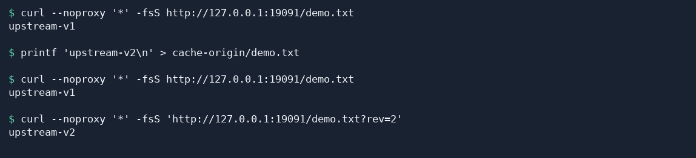

# Cache a reverse proxy site

This tutorial shows how to recognize a cache hit. You will request a local text file through Fast-Https, change it at the upstream, and compare the cached copy with the updated file.

## 1 Why cache a reverse proxy site

Caching on a reverse proxy can improve web application performance, make browsing smoother, and reduce load on the backend during traffic peaks. The backend that receives forwarded requests is called the upstream. With caching enabled, Fast-Https stores upstream responses that match the configured rules so it can reuse them for later requests.

- **Improve performance.** When a visitor requests an uncached resource, Fast-Https fetches it from the upstream and stores the response if it matches the cache rules. On a later cache hit, the proxy serves the copy directly, reducing upstream requests and response wait time.
- **Reduce work for the backend.** Static resources such as images, CSS files, and JavaScript files are often requested repeatedly. Serving them from the proxy's cache leaves the application more CPU and connection capacity for dynamic requests such as sign-ins and queries.
- **Save bandwidth.** The cached copy is stored on the server running the Fast-Https proxy. On a hit, the proxy sends the copy straight to the visitor, saving another transfer from the upstream to the proxy.
- **Improve the browsing experience.** Pages often load images, stylesheets, and scripts. Shorter waits for these resources help pages appear sooner and let visitors move more smoothly between pages.
- **Keep the service stable during peaks.** A popular resource can receive many requests in a short time. Cache hits absorb repeated traffic and smooth out backend load. In a deployment with multiple backends, load balancing distributes requests that need to reach an upstream, while the cache reduces repeated upstream requests. Together, they help limit the effect of one overloaded backend on the site.
- **Support resource updates.** Use `valid` to choose a cache duration based on how often a resource changes. When you update an image, stylesheet, or script, you can set a version parameter in its URL, for example `style.css?v=2`. If the cache key includes the query string, the URL with the new parameter value gets its own key. The first request for that URL can fetch the updated resource from the upstream.
- **Protect the backend entry point.** When only the Fast-Https entry point is exposed to visitors, the upstream can listen on a loopback address or stay on a private network that only the proxy can reach. The example below binds the upstream to `127.0.0.1`. For public resources that change infrequently, a longer cache duration can also reduce the number of requests sent to the upstream while a copy is valid.

## 2 Enable the cache on a reverse proxy site

For an existing reverse proxy, add `proxy_cache` alongside `proxy_pass` in the `"type": "proxy"` location you want to cache. Save and reload the configuration.

### 2.1 Prepare a local upstream

The commands use Linux, with Ubuntu as an example, and require Python 3 and `curl`. The JSON configuration also applies to Windows. Download the archive for your operating system and processor architecture and extract it into a new test directory. Run the commands from the extracted directory containing `fast-https`, `config`, and `httpdoc`. [Fast-Https v1.5.0 release](https://github.com/ncepu-iDealStudio/Fast-Https/releases/tag/v1.5.0)

In terminal A, create a directory for the test file.

```bash
mkdir cache-origin
```

Create the file.

```bash
printf 'upstream-v1\n' > cache-origin/demo.txt
```

Start the upstream server. Keep terminal A running.

```bash
python3 -m http.server 19090 --bind 127.0.0.1 --directory cache-origin
```

### 2.2 Configure and start the reverse proxy

Replace `config/fast-https.json` in the **test directory** with the JSON below. Fast-Https accepts requests on port `19091` and fetches the file from the Python server on port `19090`.

```json
{
  "http": {
    "server": [
      {
        "listen": 19091,
        "server_name": "localhost",
        "location": [
          {
            "url": "/",
            "type": "proxy",
            "proxy_pass": "http://127.0.0.1:19090",
            "proxy_cache": {
              "path": "cache-demo-store",
              "valid": ["200:5m"],
              "key": "$request_method$host$request_uri"
            }
          }
        ]
      }
    ]
  }
}
```

In terminal B, go to the same extracted directory and start Fast-Https.

```bash
FASTHTTPS_FOREGROUND=1 ./fast-https start
```

When terminal B reports that Fast-Https is listening on `19091`, open terminal C in the same directory and continue.

## 3 Verify a cache hit

1. Request the file through the proxy. The first request returns `upstream-v1`, and Fast-Https writes that successful response to the cache.

   ```bash
   curl --noproxy '*' -fsS http://127.0.0.1:19091/demo.txt
   ```

2. Give the cache a second to write, then update the upstream file in terminal C.

   ```bash
   printf 'upstream-v2\n' > cache-origin/demo.txt
   ```

3. Request the same URL again. It still returns `upstream-v1`, the copy stored by the first request.

   ```bash
   curl --noproxy '*' -fsS http://127.0.0.1:19091/demo.txt
   ```

4. Add a query parameter to the URL. The request URI changes, so Fast-Https uses a new cache key and fetches `upstream-v2` from the upstream.

   ```bash
   curl --noproxy '*' -fsS 'http://127.0.0.1:19091/demo.txt?rev=2'
   ```



When you finish, stop Fast-Https from terminal C. Then press `Ctrl+C` in terminal A to stop the Python server.

```bash
./fast-https stop
```

## 4 Choose rules for your site

| Field | Purpose |
| --- | --- |
| `path` | Directory for cache files. Choose a directory that Fast-Https can write to. |
| `valid` | Cache duration by upstream response status. For example, `"200:5m"` caches successful responses for five minutes. |
| `key` | Identifies a stored response. Combine `$request_method` (request method), `$host` (request host), and `$request_uri` (path and query string) as needed. |

`valid` can contain several rules. For example, `["200:1h", "304:1h", "any:30m"]` sets a one-hour duration for `200` and `304` responses and uses 30 minutes for other statuses. For your first configuration, cache only `200` responses, as in this tutorial.

Visitors share the example's cache key. Use it for content all visitors can access, such as public images and stylesheets.
