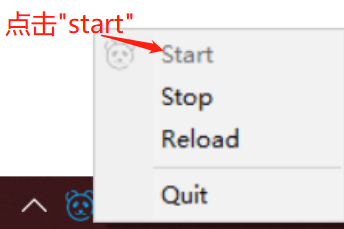

# Serve a site over HTTPS

Moving from HTTP to HTTPS takes three steps: start the service, download the root certificate, install it as trusted. This page explains the difference between HTTP and HTTPS first, then the Windows procedure.

## 1 What HTTP and HTTPS are

HTTP (HyperText Transfer Protocol) is the foundation for transferring and sharing information on the World Wide Web, but it has a clear security flaw: unauthorised people can attack it and steal data easily. HTTPS (HTTP Secure) is the second generation of HTTP, making e-commerce, online banking, instant messaging, video chat, file transfer and cloud storage safe to use.

### 1.1 The SSL protocol makes the difference

The key difference between HTTP and HTTPS is the SSL certificate. An SSL (Secure Sockets Layer) certificate encrypts data before it is sent or received between the web server and the browser, so malicious software, viruses and other threats cannot slip into the end user's network.

| Detail | HTTP | HTTPS |
| --- | --- | --- |
| URL | Prefixed with `http://` | Prefixed with `https://` |
| Port | 80 | 443 |
| Security | Known security issues | Removes threats to online data exchange |

### 1.2 Why migrating to HTTPS matters

- Search engines treat HTTPS as a ranking signal, so HTTPS pages are more likely to appear near the top of results;
- Mainstream browsers label HTTP pages that collect passwords or card details as "not secure";
- Customers see HTTPS as a sign of confidence and safety;
- HTTP/2 performs significantly better than HTTP/1.1 in all browsers, and adopting HTTP/2 requires HTTPS.

### 1.3 Benefits of serving a site over HTTPS

- **Encryption**: SSL/TLS encrypts data so credentials, passwords and card numbers cannot be intercepted or tampered with;
- **Authentication**: digital certificates verify the server identity, preventing phishing sites and man-in-the-middle attacks;
- **Integrity**: content cannot be modified in transit;
- **Trust**: the padlock icon and HTTPS prefix are the first signal of trust;
- **SEO**: HTTPS is a ranking factor;
- **Compliance**: regulations such as GDPR require protecting user data;
- **Anti-hijacking**: prevents injected ads or malware;
- **Future standards**: HTTPS has become the default for network communication.

## 2 Configure a self-signed certificate

### 2.1 Step one — start Fast-Https

Click the tray icon in the notification area to start the local web service:



### 2.2 Download the root certificate

Open `http://localhost:8080/` in a browser to see the default Fast-Https start page, then click **Download Certificate** to save `root.crt`.

### 2.3 Install the certificate on Windows

1. Find `root.crt` in your download folder and double click it;
2. In the import wizard choose **Current user**;
3. Select "Place all certificates in the following store" and click **Next** through the wizard;
4. Click **Yes** on the security warning about installing a certificate from a certification authority; "The import was successful" confirms the installation.

<div class="admon">
<svg viewBox="0 0 24 24" fill="none" stroke="currentColor" stroke-width="2"><circle cx="12" cy="12" r="9"/><path d="M12 8v5M12 16h.01"/></svg>
<div>For a browser to trust a self-signed certificate, the root certificate must be imported into the system trust store. Repeat the import on another machine, or in browsers that keep their own store such as Firefox.</div>
</div>

### 2.4 Test the result

Open:

```
https://localhost
```

A padlock in the address bar means the certificate is in effect.

## 3 Related reading

- Automatic redirect from port 80 to HTTPS: [Configure redirects](/en/docs/tutorial/redirects/)
- How the encrypted site block is written: [Basic configuration](/en/docs/tutorial/basic-configuration/)
