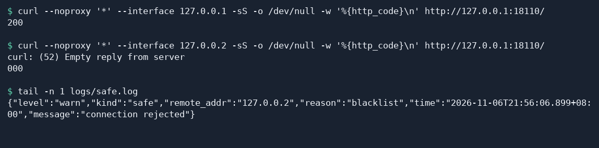
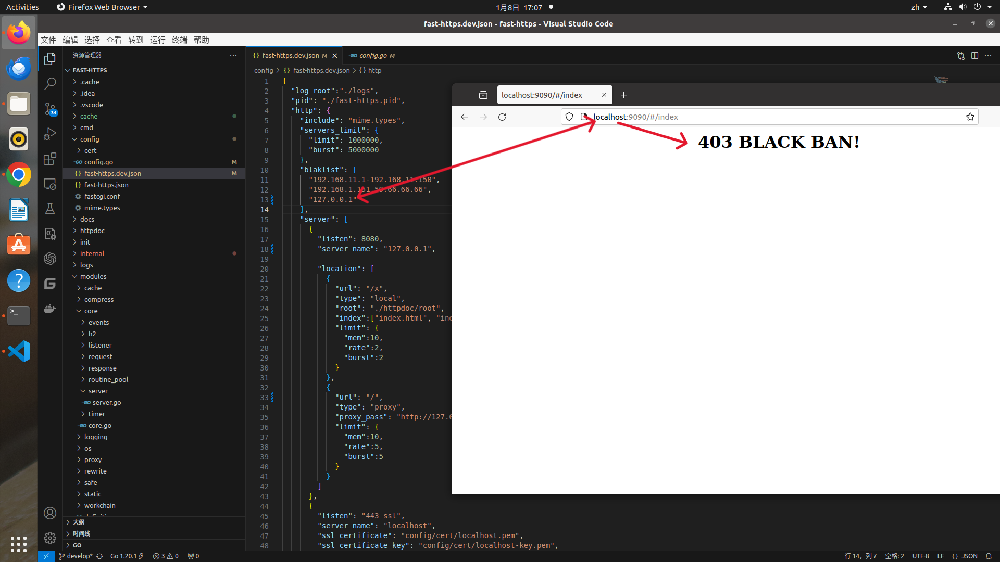

# Block IP addresses

This tutorial shows how to reject connections by client IP and verify the result in the security log.

## 1 Why block IP addresses

An IP blocklist controls access by source address. Fast-Https can reject connections from selected client IPs before forwarding traffic to the app. Use it when you have identified sources that should be blocked.

- **Block known malicious traffic.** After identifying sources of denial-of-service traffic, brute-force login attempts, or code injection attempts, add their IPs to block further connections from those addresses.
- **Protect server resources.** Abusive traffic consumes bandwidth, CPU, and memory. Rejecting known sources early reduces the work of handling and responding to their requests.
- **Reduce data risks.** When a source repeatedly attempts to read or modify data without authorization, blocking further connections can reduce repeat attempts. Use this alongside authentication and authorization controls to protect data.
- **Maintain the browsing experience.** Sustained abusive traffic can consume capacity that legitimate requests need. Blocking known sources leaves more capacity for regular visitors and reduces the risk of slow or unavailable pages.
- **Apply compliance and access requirements.** If your access policy identifies particular IPs or ranges to restrict, put those addresses into deny rules and review the rules and their scope periodically.
- **Simplify log analysis.** Filter the security log by `blacklist` to review blocked addresses together and investigate other requests separately.
- **Scope access controls.** Use a single IP, several IPs, or a contiguous range to limit a rule to the addresses you need to block.
- **Protect the site's reputation.** Sustained abuse can disrupt normal service and erode visitor trust. Blocking confirmed sources can reduce how long their activity affects visitors.

Several visitors can share one public IP. Check whom an entry affects before adding it, and review your entries periodically. A deployment can combine the blocklist with firewall allow rules and intrusion detection.

## 2 Configure the blocklist

Set `blaklist` inside the `http` object in `config/fast-https.json`. Spell the key exactly as `blaklist`. The rules apply to the current Fast-Https instance and match the source IP of each connection. If traffic passes through another proxy first, check which source IP Fast-Https receives before adding a rule.

| Addresses to block | One entry in the `blaklist` array |
| --- | --- |
| One address | `"192.0.2.10"` |
| Multiple addresses | `"198.51.100.8,203.0.113.9"` |
| A range, including both endpoints | `"192.0.2.30-192.0.2.40"` |

You can combine multiple entries in the same array. For an existing site, update `http.blaklist`, save, and reload.

## 3 Verify a blocked connection locally

The example uses `curl` and two Linux loopback addresses to simulate different clients. The steps use Ubuntu as an example. The JSON configuration also applies to Windows. Extract the archive for your architecture into a new test directory. Replace `config/fast-https.json` in the **test directory** with the JSON below to serve the welcome page on port `18110` and add one blocklist entry. [Fast-Https v1.5.0 release](https://github.com/ncepu-iDealStudio/Fast-Https/releases/tag/v1.5.0)

```json
{
  "http": {
    "blaklist": ["127.0.0.2"],
    "server": [
      {
        "listen": 18110,
        "server_name": "localhost",
        "location": [
          {
            "url": "/",
            "type": "local",
            "root": "./httpdoc/root",
            "index": ["index.html"]
          }
        ]
      }
    ]
  }
}
```

Start the service in the extracted directory containing `fast-https`.

```bash
FASTHTTPS_FOREGROUND=1 ./fast-https start
```

When the log shows that the server is listening on `18110`, open a second terminal in the same directory. Send a request from the allowed address `127.0.0.1`. Expect `200`.

```bash
curl --noproxy '*' --interface 127.0.0.1 -sS -o /dev/null -w '%{http_code}\n' http://127.0.0.1:18110/
```

Then request the same site from the blocked address `127.0.0.2`. The `--interface` option changes the source address while leaving the destination the same.

```bash
curl --noproxy '*' --interface 127.0.0.2 -sS -o /dev/null -w '%{http_code}\n' http://127.0.0.1:18110/
```

In the v1.5.0 Linux release, Fast-Https closes a connection that matches the blocklist. `curl` can report an empty reply with `000`. Check the security log to confirm why the connection was rejected.

```bash
tail -n 1 logs/safe.log
```

Look for `"remote_addr":"127.0.0.2"` and `"reason":"blacklist"` in that entry.



The screenshot shows a block message in the browser (the sample site is for testing only).



## 4 Remove the block

Set `blaklist` to `[]` in the test configuration, save, and reload from the second terminal.

```bash
./fast-https reload
```

Run the same `curl` command from `127.0.0.2` again. It should now return `200`. Stop the test service when you finish.

```bash
./fast-https stop
```
