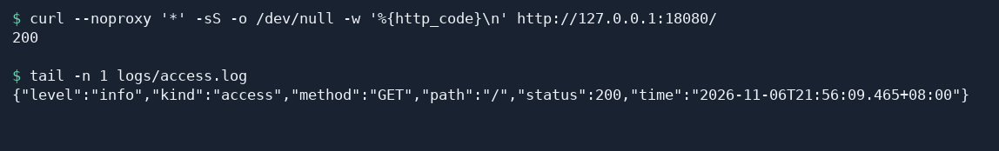

# Other default options

The access log shows which path a client requested and which status the server returned. Fast-Https v1.5.0 writes one JSON record per line to `logs/access.log` by default. Use `http.log_format` to select the request and response fields you want to record.

## 1 Select fields to record

Open `config/fast-https.json` and find the existing `http` object. Change its `log_format` to the value below, or add the field if it is missing. The JSON shows where the field belongs. Keep your existing sites and other settings in the file.

```json
{
  "http": {
    "log_format": ["method", "path", "status"]
  }
}
```

Save the file. Fast-Https reads the saved configuration the next time it starts. If it is already running, reload the configuration with the following Linux command from the directory containing the executable.

```bash
./fast-https reload
```

## 2 Make a request and read the log

Request a running site. The command uses the local HTTP address from [Serve a site over HTTPS](/en/docs/tutorial/https-access/). Substitute your site's address if you are using a different site.

```bash
curl --noproxy '*' -sS -o /dev/null -w '%{http_code}\n' http://127.0.0.1:18080/
```

After you receive `200`, read the latest entry from the extracted directory. If you set `log_root`, look in that directory.

```bash
tail -n 1 logs/access.log
```

The example below shows the result. The timestamp varies, and the `method`, `path`, and `status` match your request.

```json
{"level":"info","kind":"access","method":"GET","path":"/","status":200,"time":"2026-11-06T07:27:07.851-05:00"}
```



## 3 Available fields

| Name in `log_format` | Recorded value |
| --- | --- |
| `ip_port` | Client IP and port, written as `remote_addr` |
| `time` | Log timestamp |
| `type` | How Fast-Https handled the request, such as `LOCAL` for a static file |
| `method` | HTTP method, such as `GET` |
| `path` | Request path |
| `host` | Request Host |
| `status` | HTTP response status |
| `size` | Response body size in bytes |
| `user_agent` | Client User-Agent |

Omit `log_format` or set it to an empty array to use the default set in the table. Each record includes `level`, `kind`, and `time` even when you select only `method`, `path`, and `status`. If the configuration contains `log_split`, remove that field. If the `log_format` array contains `referer`, remove that entry. Read the access log by JSON field name.
