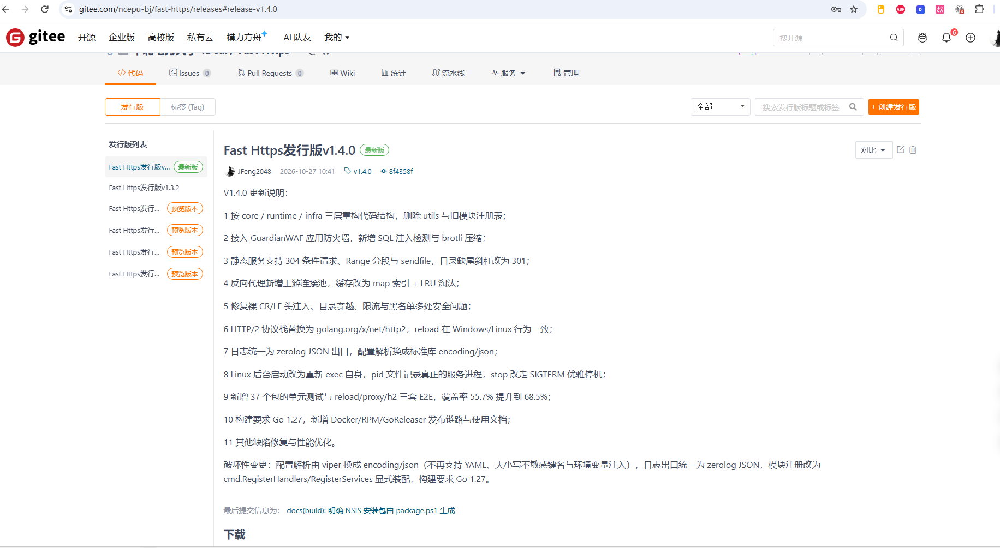
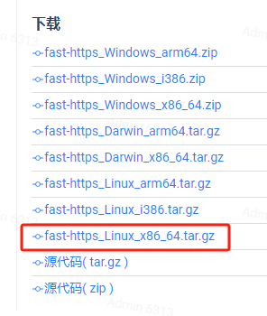
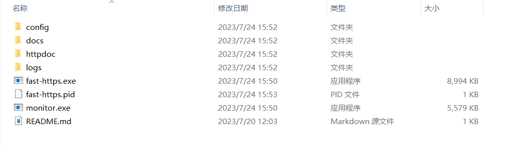
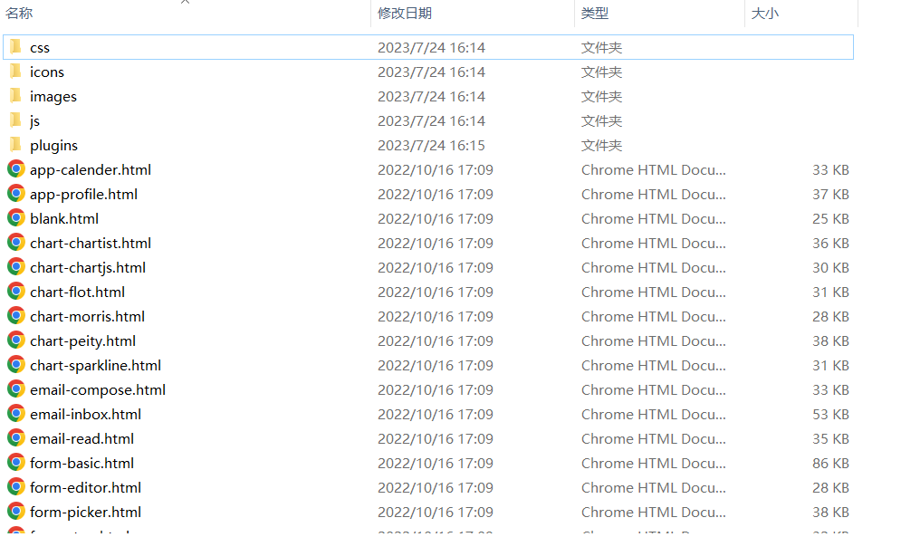
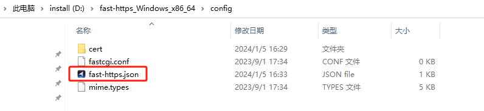
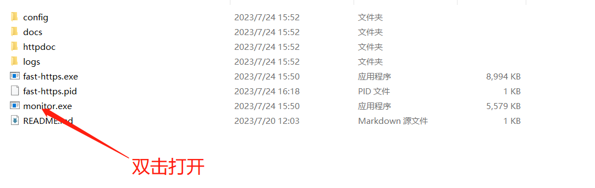
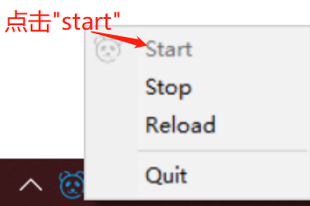
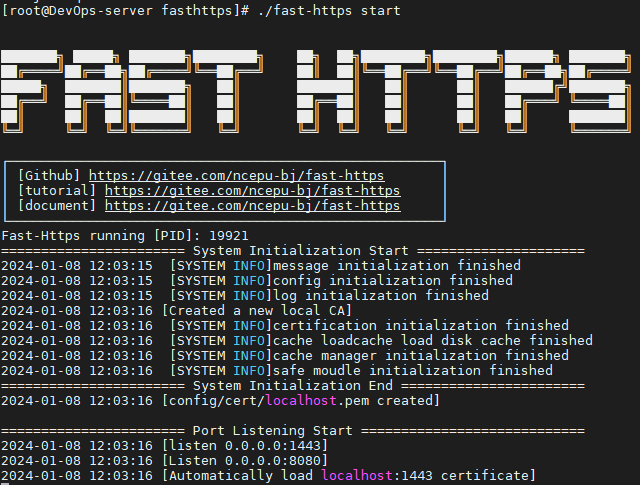

# Publish a local static site

This page walks through publishing a static website with Fast-Https on both Windows and Linux.

## 1 Get the software

Open the release page and pick the build for your platform:

<https://gitee.com/ncepu-bj/fast-https/releases>

- Windows: `fast-https_Windows_x86_64.zip` is enough in most cases;
- Linux: match the CPU architecture; for a regular x86 server use `fast-https_Linux_x86_64.tar.gz`.





## 2 Install on Windows

### Unpack the archive

Unzip the downloaded package:



Copy the unpacked folder somewhere convenient — below we assume `D:\fast-https_Windows_x86_64`.

### Upload the site files

Create a folder per site under `D:\fast-https_Windows_x86_64\httpdoc`, named after the domain, e.g. `www.myweb.com`, and copy your static files into `D:\fast-https_Windows_x86_64\httpdoc\www.myweb.com`:



### Edit the configuration file

Open the main configuration file `fast-https.json` in `D:\fast-https_Windows_x86_64\config`:



Edit it as follows:

```json
{
  "log_root": "./logs",
  "pid": "./fast-https.pid",
  "http": {
    "include": "mime.types",
    "server": [
      {
        "listen": 8080,
        "server_name": "localhost",
        "location": [
          {
            "url": "/",
            "type": "local",
            "root": "./httpdoc/www.myweb.com",
            "index": ["index.html", "index.htm"]
          }
        ]
      },
      {
        "listen": "443 ssl",
        "server_name": "localhost",
        "ssl_certificate": "config/cert/localhost.pem",
        "ssl_certificate_key": "config/cert/localhost-key.pem",
        "location": [
          {
            "url": "/",
            "type": "local",
            "root": "./httpdoc/www.myweb.com",
            "index": ["index.html", "index.htm"]
          }
        ]
      }
    ]
  }
}
```

There are two site blocks: a plain listener on 8080 and an encrypted listener on 443, both serving the same directory.

### Start the monitor program

Find and double click `monitor.exe` in `D:\fast-https_Windows_x86_64`:



Then click the tray icon in the notification area to start the service:



Open `http://localhost:8080` in a browser and the site appears:


### Access the site by domain

Set `server_name` to your domain:

```
"server_name": "www.myweb.com"
```

Then add a local entry to your hosts file (usually `C:\Windows\System32\drivers\etc\hosts`):

```
127.0.0.1 www.myweb.com
```

After saving, the site is reachable at `http://www.myweb.com:8080`.

## 3 Install on Linux

### 3.1 Upload the site files

Create `/usr/local/fast-https/httpdoc/www.myweb.com` and copy your static files into it:


### 3.2 Edit the configuration file

```bash
$ vi /usr/local/fast-https/config/fast-https.json
```

The content is identical to the Windows example above; just make sure `root` points to `./httpdoc/www.myweb.com`.

### 3.3 Start and test

```bash
$ ./fast-https
```



Started this way the process ends with the terminal session. For production, run it in the background:

```bash
$ nohup ./fast-https &
```

Open `http://ip:8080/index.html` and the deployed site is served:


<div class="admon">
<svg viewBox="0 0 24 24" fill="none" stroke="currentColor" stroke-width="2"><circle cx="12" cy="12" r="9"/><path d="M12 8v5M12 16h.01"/></svg>
<div>When accessing the server from a remote browser, set <code>server_name</code> to the server IP or a resolved domain. If ports 80/443 are already taken, verify with another port first.</div>
</div>
