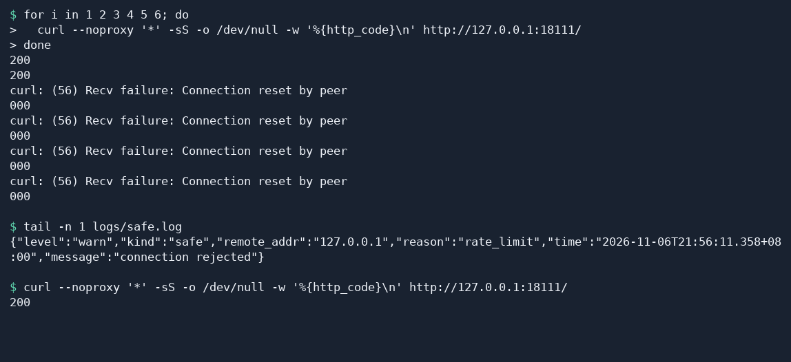

# Rate limit a web app

This tutorial shows how to limit the connection rate for a client IP and verify that access recovers after the limit is reached.

## 1 Why limit the connection rate

Rate limiting controls how much service capacity a client can use over a period of time. This tutorial uses the Fast-Https global rate limit, which sets a rate and a burst allowance for new connections from each client IP. Use it to control sources that open too many connections in a short period.

- **Protect server resources.** Handling many new connections consumes CPU, memory, and network capacity. Controlling the arrival rate can reduce the load from bursts.
- **Maintain service quality.** During periods of high concurrency, limiting the load from one source leaves the backend more capacity to respond consistently as traffic rises.
- **Reduce the impact of malicious traffic.** Rapid connection attempts can crowd out normal traffic. A per-IP limit constrains one source. For distributed denial-of-service traffic, each source has its own allowance, and overall protection also depends on the network and upstream deployment.
- **Keep access fair.** Each client IP has its own allowance. This limits how much capacity a script or a client retrying repeatedly can occupy and leaves capacity for other sources.
- **Control costs.** For services billed by resource usage, choose connection allowances based on typical traffic to reduce the extra resource use from unusual spikes.
- **Improve the user experience.** Limiting abusive connections during busy periods helps reduce slow or temporarily unavailable pages, making it easier for visitors to browse and complete tasks.
- **Apply access rate requirements.** If a site has a connection rate or burst allowance requirement, set the corresponding limits and use the security log to check when they take effect.

## 2 Configure a test site

The `http.servers_limit` settings apply to the instance. In v1.5.0, the global limiter checks each client IP when a new connection arrives. Each `curl` invocation in the test loop opens a new connection. Requests that reuse an HTTP/1.1 connection share that one connection allowance.

The test uses `curl` on Linux, with Ubuntu as an example. The JSON configuration also applies to Windows. Extract the archive for your architecture into a new test directory, then replace `config/fast-https.json` in the **test directory** with the JSON below. For an existing instance, adjust `http.servers_limit` while keeping your sites and other settings. [Fast-Https v1.5.0 release](https://github.com/ncepu-iDealStudio/Fast-Https/releases/tag/v1.5.0)

```json
{
  "http": {
    "servers_limit": {
      "limit": 1,
      "burst": 2
    },
    "server": [
      {
        "listen": 18111,
        "server_name": "localhost",
        "location": [
          {
            "url": "/",
            "type": "local",
            "root": "./httpdoc/root",
            "index": ["index.html"]
          }
        ]
      }
    ]
  }
}
```

Start the test site in the extracted directory containing `fast-https`.

```bash
FASTHTTPS_FOREGROUND=1 ./fast-https start
```

## 3 Trigger the limit and check recovery

When the log shows that the server is listening on `18111`, open a second terminal in the same directory. Make six quick requests and print the status of each one. Copy and run the entire loop.

```bash
for i in 1 2 3 4 5 6; do
  curl --noproxy '*' -sS -o /dev/null -w '%{http_code}\n' http://127.0.0.1:18111/
done
```

The test requests return `200` while the client IP still has burst allowance. Connections that arrive in quick succession can use up the allowance faster than it refills. With the v1.5.0 Linux release, a limited connection can reset, and `curl` can display `000` and `Connection reset by peer`. Look for `"reason":"rate_limit"` in the security log to confirm why Fast-Https rejected the connection.

```bash
tail -n 1 logs/safe.log
```

Wait at least two seconds, then make one more request.

```bash
curl --noproxy '*' -sS -o /dev/null -w '%{http_code}\n' http://127.0.0.1:18111/
```

A `200` confirms that the allowance has recovered and the same IP can access the site again.



Stop the test service when you finish.

```bash
./fast-https stop
```

## 4 Choose limits for your service

| `servers_limit` field | Meaning | v1.5.0 release default |
| --- | --- | --- |
| `limit` | Allowance added per second for each IP. `0` disables this rate limit. | `0` |
| `burst` | Maximum allowance each IP can accumulate. Each new connection consumes one unit. Use a positive value when enabling the limit. | `0` |
| `max_header_size` | Maximum request header size in bytes | `4096` (4 KiB) |
| `max_body_size` | Maximum request body size in bytes, including uploads | `524288` (512 KiB) |

With `limit: 1` and `burst: 2`, an IP can initially open two connections in quick succession and regains one unit per second. For your service, base the values on normal connection rates and the bursts you want to allow. Adjust the request body and header limits independently. Save and reload the configuration.

The rate limiter allows access again as the allowance refills. To keep selected addresses blocked, use the [IP blocklist](/docs/tutorial/ip-blocklist/).
