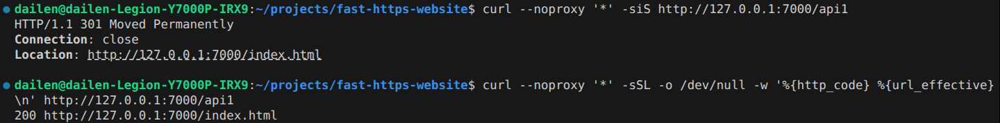
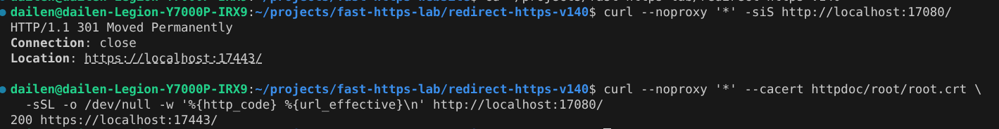

# Configure redirects

## 1 What a redirect is

A redirect is a server response technique that sends a user from one page or domain to another. It can be implemented on the server or the client, and the action is indicated mainly by an HTTP status code. A 301 redirect, for instance, is a permanent redirect meaning the resource of the old address has moved permanently to the new one.

Common scenarios:

- **Domain change**: when a site moves to a new domain, a 301 redirect sends visitors of the old domain to the new one while keeping search rankings and link equity;
- **Site structure optimisation**: after a redesign, old URLs redirect to the new structured pages;
- **Page migration**: a page moved elsewhere redirects visitors from the old address;
- **Handling error pages**: users are redirected from an error page to the correct one;
- **Multi-version sites**: the www and non-www versions use a 301 to declare the preferred domain and avoid split equity;
- **SEO strategy**: a 301 transfers page equity and avoids losses caused by URL changes.

## 2 Why redirects help

- **Consolidate equity**: equity from the old address moves to the new one, improving its ranking;
- **Better experience**: users no longer hit error pages after a URL change or page move;
- **Keep existing links**: inbound links stay valid instead of breaking;
- **Avoid duplicate content**: search engines index only one version;
- **Simpler management**: a sound redirect policy simplifies maintenance of large sites.

## 3 Redirect configuration

This example was tested with Fast-Https v1.4.0 on Linux x86_64. Extract the release archive into a separate test directory and check that it contains `fast-https` and `httpdoc/root/index.html`. This example uses port `7000`, which must be available. [v1.4.0 release](https://github.com/ncepu-iDealStudio/Fast-Https/releases/tag/v1.4.0)

### 3.1 Configure the test site

Open `config/fast-https.json` in the test directory and save the following configuration.

```json
{
  "http": {
    "server": [
      {
        "listen": 7000,
        "server_name": "localhost",
        "location": [
          {
            "url": "/api1",
            "type": "rewrite",
            "rewrite": "http://127.0.0.1:7000/index.html"
          },
          {
            "url": "/",
            "type": "local",
            "root": "./httpdoc/root",
            "index": ["index.html"]
          }
        ]
      }
    ]
  }
}
```

The first `location` matches `/api1`, returns `301`, and sets the `Location` response header to the URL in `rewrite`. The second serves `index.html` from `./httpdoc/root`.

### 3.2 Start and verify

From the test directory, check the configuration.

```bash
./fast-https check
```

When you see `config ok`, start Fast-Https.

```bash
./fast-https start
```

Once the server is running, open another terminal and request `/api1` to see the initial response.

```bash
curl --noproxy '*' -siS http://127.0.0.1:7000/api1
```

The response includes `301` and the redirect URL.

```text
HTTP/1.1 301 Moved Permanently
Connection: close
Location: http://127.0.0.1:7000/index.html
```

Use `-L` to follow the redirect and see the final status code and URL.

```bash
curl --noproxy '*' -sSL -o /dev/null -w '%{http_code} %{url_effective}\n' http://127.0.0.1:7000/api1
```

The final response is `200` at the redirect URL.

```text
200 http://127.0.0.1:7000/index.html
```



When you finish, use an available terminal to stop the server from the test directory.

```bash
./fast-https stop
```

## 4 Example: HTTP to HTTPS

Extract the same Fast-Https v1.4.0 release archive into a new empty directory. This example receives HTTP requests on port `17080` and serves the home page over HTTPS on port `17443`.

### 4.1 Configure the HTTP and HTTPS sites

Replace `config/fast-https.json` in the new directory with the following configuration.

```json
{
  "http": {
    "server": [
      {
        "listen": 17080,
        "server_name": "localhost",
        "location": [
          {
            "url": "/",
            "type": "rewrite",
            "rewrite": "https://localhost:17443/"
          }
        ]
      },
      {
        "listen": "17443 ssl",
        "server_name": "localhost",
        "ssl_certificate": "config/cert/localhost.pem",
        "ssl_certificate_key": "config/cert/localhost-key.pem",
        "location": [
          {
            "url": "/",
            "type": "local",
            "root": "./httpdoc/root",
            "index": ["index.html"]
          }
        ]
      }
    ]
  }
}
```

The first `server` uses `rewrite` to redirect requests to a fixed HTTPS URL. The second loads the certificate and private key and serves `./httpdoc/root/index.html` over HTTPS.

### 4.2 Start the server and verify the redirect

Start Fast-Https from the new test directory. On first start, it generates the `localhost` certificate and private key, along with `httpdoc/root/root.crt` for verification. Running `./fast-https check` before the first start reports that the certificate file is missing.

```bash
FASTHTTPS_FOREGROUND=1 ./fast-https start
```

When you see `Listen 0.0.0.0:17080` and `Listen 0.0.0.0:17443`, leave the server running. Open another terminal in the same test directory and check the HTTP response.

```bash
curl --noproxy '*' -siS http://localhost:17080/
```

```text
HTTP/1.1 301 Moved Permanently
Connection: close
Location: https://localhost:17443/
```

Use `-L` to follow the redirect and `--cacert` to use the CA certificate generated in the test directory. The two lines below form one command.

```bash
curl --noproxy '*' --cacert httpdoc/root/root.crt \
  -sSL -o /dev/null -w '%{http_code} %{url_effective}\n' http://localhost:17080/
```

After certificate verification succeeds, the final HTTPS page returns `200`.

```text
200 https://localhost:17443/
```



Stop the test server from the terminal used for verification.

```bash
./fast-https stop
```

### 4.3 Use the configuration in production

For standard ports, set `listen` to `80` and `"443 ssl"` on the two sites and set both `server_name` values to your domain. Set `rewrite` to its HTTPS URL, such as `https://example.com/`. Point `ssl_certificate` and `ssl_certificate_key` to a certificate trusted by clients for your domain and its matching private key.
