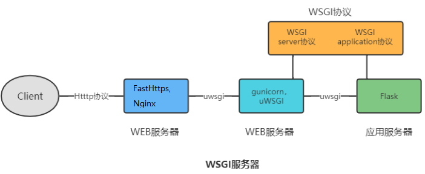
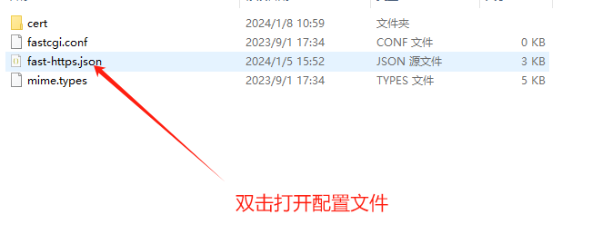

# Reverse proxy a site

Like Nginx, Fast-Https can reverse proxy server-side applications (PHP, Python, Java APIs or services) and works well as the front-end web server for a web application.



## Configure a reverse proxy on Windows

### 1 Start the upstream service

Start the application you want to proxy. Suppose you are deploying a Python Flask service — **first make sure it runs correctly on this machine**.

### 2 Edit the configuration file

Open `fast-https.json` in the `config` folder and configure the site:



#### 2.1 Minimal reverse proxy configuration

```json
{
  "log_root": "./logs",
  "pid": "./fast-https.pid",
  "http": {
    "include": "mime.types",
    "server": [
      {
        "listen": 80,
        "server_name": "api.abc.com",
        "location": [
          {
            "url": "/",
            "type": "proxy",
            "proxy_pass": "http://127.0.0.1:5000",
            "proxy_set_header": [
              {
                "HeaderKey": "Host",
                "HeaderValue": "$host"
              },
              {
                "HeaderKey": "Connection",
                "HeaderValue": "close"
              }
            ]
          }
        ]
      }
    ]
  }
}
```

| Option | Description |
| --- | --- |
| `listen` | Port the server listens on |
| `server_name` | Domain configured for this site |
| `url` | Request path that must be matched, or a regular expression; usually just `/` |
| `type` | `proxy` enables reverse proxying |
| `proxy_pass` | Upstream address and port to proxy to — a Python API, a PHP endpoint or a Java service; here a local Flask service |
| `proxy_set_header` | Replaces request headers while proxying; `HeaderKey` is the name, `HeaderValue` the value |

#### 2.2 About `proxy_set_header`

Values starting with `$` are built-in variables replaced with real values; anything else is used literally. If the header did not exist, it is added.

1. `$host` — replaced with the `server_name` of the site in the configuration;
2. `$proxy_host` — replaced with the host name given in `proxy_pass`.

A common header configuration:

```
"proxy_set_header" : [
              {
                "HeaderKey": "Host",
                "HeaderValue": "$proxy_host"
              },
              {
                "HeaderKey": "Connection",
                "HeaderValue": "close"
              }
]
```

Which one to use depends on how the upstream validates the `Host` header.

### 3 WebSocket upstreams

1. If the upstream server exposes WebSocket endpoints, **no** extra option is needed in `proxy_pass`;
2. After configuring, `ws://api.quwancode.com/XXXX` reaches the matching WebSocket endpoint on the upstream server.

<div class="admon">
<svg viewBox="0 0 24 24" fill="none" stroke="currentColor" stroke-width="2"><circle cx="12" cy="12" r="9"/><path d="M12 8v5M12 16h.01"/></svg>
<div>To speed up a reverse proxied site, add <code>proxy_cache</code> to the <code>location</code> — see "Cache a reverse proxy site".</div>
</div>
