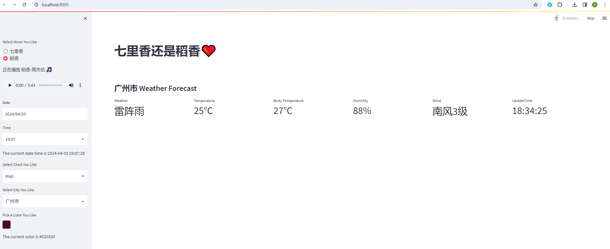

# Reverse proxy a WebSocket service

<div class="admon">
<svg viewBox="0 0 24 24" fill="none" stroke="currentColor" stroke-width="2"><circle cx="12" cy="12" r="9"/><path d="M12 8v5M12 16h.01"/></svg>
<div>Two things worth knowing about WebSocket support:<br>1. If the upstream server exposes WebSocket endpoints, <strong>no</strong> extra option is needed in <code>proxy_pass</code>;<br>2. Once configured, <code>ws://api.quwancode.com/XXXX</code> reaches the matching WebSocket endpoint on the upstream server.</div>
</div>

## 1 The target project

Here is a concrete Streamlit project that exposes a WebSocket endpoint:

<https://github.com/JuneWaySue/my_streamlit_app>

Clone it locally, then install the dependencies:

```bash
$ pip install -r requirements.txt
```

Run the application:

```bash
$ streamlit run my_streamlit.py
```

The web service listens on `http://localhost:8501`:



## 2 Configure the Fast-Https proxy

Now proxy this project through Fast-Https on port 80 under a domain. Assume the domain is `www.abc.com`; add it to your hosts file first:

```
127.0.0.1 www.abc.com
```

A reference `fast-https.json`:

```json
{
  "log_root": "./logs",
  "pid": "./fast-https.pid",
  "http": {
    "include": "mime.types",
    "server": [
      {
        "listen": 80,
        "server_name": "www.abc.com",
        "location": [
          {
            "url": "/",
            "type": "proxy",
            "proxy_pass": "http://127.0.0.1:8501",
            "proxy_set_header": [
              {
                "HeaderKey": "Host",
                "HeaderValue": "$host"
              }
            ]
          }
        ]
      }
    ]
  }
}
```

What the options mean:

| Option | Description |
| --- | --- |
| `log_root` | Log root directory `./logs` |
| `pid` | Path of the process PID file `./fast-https.pid` |
| `http.include` | Includes `mime.types` (MIME type table) |
| `listen` | Listening port `80` |
| `server_name` | Domain `www.abc.com` |
| `location[].url` | Matched path `/`, i.e. proxy the whole site |
| `location[].type` | Handler `proxy`, i.e. reverse proxy |
| `location[].proxy_pass` | Forward target `http://127.0.0.1:8501` |
| `location[].proxy_set_header` | Keeps the request header `Host: $host` |

## 3 Verify

Save the configuration, RELOAD, then open in a browser:

```
http://www.abc.com
```

If the page loads, the proxy works. WebSocket connections opened by the page reuse the same proxy; no separate `Upgrade` header is required.

<div class="admon">
<svg viewBox="0 0 24 24" fill="none" stroke="currentColor" stroke-width="2"><circle cx="12" cy="12" r="9"/><path d="M12 8v5M12 16h.01"/></svg>
<div>If the front end keeps disconnecting, check the idle timeout of the upstream service and whether <code>proxy_set_header</code> forces <code>Connection</code> to <code>close</code>.</div>
</div>
