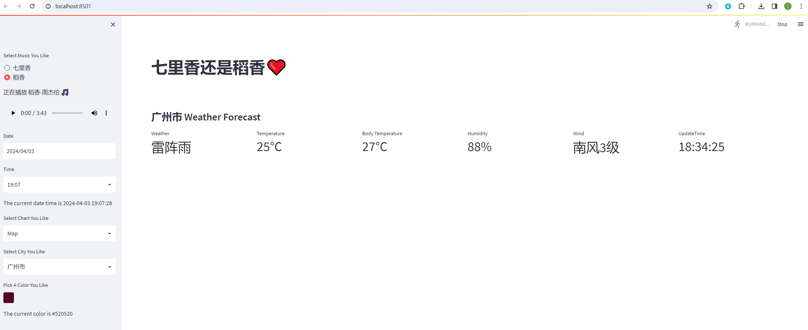

# 反向代理 WebSocket 接口项目

<div class="admon">
<svg viewBox="0 0 24 24" fill="none" stroke="currentColor" stroke-width="2"><circle cx="12" cy="12" r="9"/><path d="M12 8v5M12 16h.01"/></svg>
<div>关于 WebSocket 接口支持的两点结论：<br>1. 上游服务器中如果有 WebSocket 接口，<strong>不需要</strong>在 <code>proxy_pass</code> 项中进行特别额外的配置；<br>2. 配置后，可以通过 <code>ws://api.quwancode.com/XXXX</code> 访问到上游服务器中相应的 WebSocket 接口。</div>
</div>

## 一 需要代理的目标项目

以一个具体的、包含 WebSocket 接口的 Streamlit 项目为例：

<https://github.com/JuneWaySue/my_streamlit_app>

克隆到本地后，先安装依赖：

```bash
$ pip install -r requirements.txt
```

再运行程序：

```bash
$ streamlit run my_streamlit.py
```

可以看到 Web 服务运行在 `http://localhost:8501`：



## 二 配置 Fast-Https 代理

下面把这个项目通过 Fast-Https 代理到域名，并在 80 端口访问。假定使用的域名为 `www.abc.com`，先在本机 hosts 中加入：

```
127.0.0.1 www.abc.com
```

配置文件 `fast-https.json` 参考如下：

```json
{
  "log_root": "./logs",
  "pid": "./fast-https.pid",
  "http": {
    "include": "mime.types",
    "server": [
      {
        "listen": 80,
        "server_name": "www.abc.com",
        "location": [
          {
            "url": "/",
            "type": "proxy",
            "proxy_pass": "http://127.0.0.1:8501",
            "proxy_set_header": [
              {
                "HeaderKey": "Host",
                "HeaderValue": "$host"
              }
            ]
          }
        ]
      }
    ]
  }
}
```

配置项说明：

| 配置项 | 作用 |
| --- | --- |
| `log_root` | 日志根目录 `./logs` |
| `pid` | 进程 PID 文件路径 `./fast-https.pid` |
| `http.include` | 引入 `mime.types`（MIME 类型表） |
| `listen` | 监听端口 `80` |
| `server_name` | 域名 `www.abc.com` |
| `location[].url` | 匹配路径 `/`，即全站代理 |
| `location[].type` | 处理类型 `proxy`，即反向代理 |
| `location[].proxy_pass` | 转发目标 `http://127.0.0.1:8501` |
| `location[].proxy_set_header` | 透传请求头，`Host: $host` |

## 三 验证

保存配置后 RELOAD，在浏览器中访问：

```
http://www.abc.com
```

页面正常加载即说明代理生效；页面内触发的 WebSocket 连接会自动沿用同一代理，无需再单独配置 `Upgrade` 头。

<div class="admon">
<svg viewBox="0 0 24 24" fill="none" stroke="currentColor" stroke-width="2"><circle cx="12" cy="12" r="9"/><path d="M12 8v5M12 16h.01"/></svg>
<div>如果前端连接频繁断开，请检查上游服务自身的空闲超时设置，以及 <code>proxy_set_header</code> 中是否把 <code>Connection</code> 强制写成了 <code>close</code>。</div>
</div>
