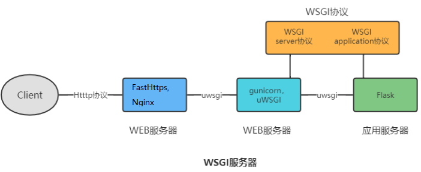
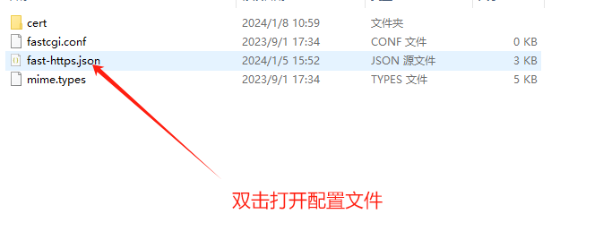

# 反向代理站点配置

Fast-Https 和 Nginx 一样，具备对服务器端应用（PHP、Python、Java 接口或服务）进行反向代理的功能，非常适合作为 Web 应用或服务的前置 Web 服务器。



## Windows 平台进行反向代理配置

### 1 启动被代理服务

先启动被代理的应用。假设要部署一个 Python Flask 服务，**首先要确定这个服务在本机可以正常运行**。

### 2 编辑配置文件

在 `config` 目录下打开 `fast-https.json` 进行站点配置：



#### 2.1 反向代理的基本配置

```json
{
  "log_root": "./logs",
  "pid": "./fast-https.pid",
  "http": {
    "include": "mime.types",
    "server": [
      {
        "listen": 80,
        "server_name": "api.abc.com",
        "location": [
          {
            "url": "/",
            "type": "proxy",
            "proxy_pass": "http://127.0.0.1:5000",
            "proxy_set_header": [
              {
                "HeaderKey": "Host",
                "HeaderValue": "$host"
              },
              {
                "HeaderKey": "Connection",
                "HeaderValue": "close"
              }
            ]
          }
        ]
      }
    ]
  }
}
```

| 配置项 | 说明 |
| --- | --- |
| `listen` | 服务器监听的端口 |
| `server_name` | 该站点配置的域名 |
| `url` | 满足的请求路径，或路径需匹配的正则表达式；一般写 `/` 即可 |
| `type` | 设为 `proxy` 表示启用反向代理 |
| `proxy_pass` | 需要代理的上游服务地址和端口，可以是 Python 接口、PHP 接口或 Java 服务；示例为本地 Flask 服务 |
| `proxy_set_header` | 代理过程中替换请求头，`HeaderKey` 是键，`HeaderValue` 是值 |

#### 2.2 关于 `proxy_set_header`

`HeaderValue` 中使用 `$` 开头的是内置变量，会被替换为实际值；不使用 `$` 则直接使用字面值。若请求头原本不存在，会新增该请求头。

1. `$host`：替换为配置文件中该站点的 `server_name`；
2. `$proxy_host`：替换为 `proxy_pass` 中指定的主机名。

一个常见的反向代理请求头配置：

```
"proxy_set_header" : [
              {
                "HeaderKey": "Host",
                "HeaderValue": "$proxy_host"
              },
              {
                "HeaderKey": "Connection",
                "HeaderValue": "close"
              }
]
```

具体用哪个，取决于服务端对 `Host` 参数的校验方式。

### 3 关于 WebSocket 接口

1. 上游服务器中如果有 WebSocket 接口，**不需要**在 `proxy_pass` 项中做任何额外配置；
2. 配置完成后，即可通过 `ws://api.quwancode.com/XXXX` 访问到上游服务器中相应的 WebSocket 接口。

<div class="admon">
<svg viewBox="0 0 24 24" fill="none" stroke="currentColor" stroke-width="2"><circle cx="12" cy="12" r="9"/><path d="M12 8v5M12 16h.01"/></svg>
<div>需要为反向代理站点加速时，可在 <code>location</code> 中追加 <code>proxy_cache</code>，参见「给反向代理站点配置缓存」。</div>
</div>
