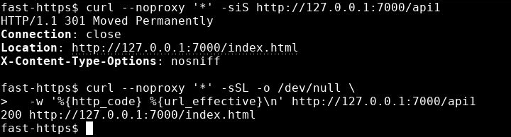
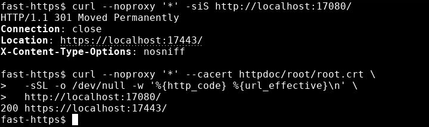

# 如何为网站配置重定向功能

本教程用 Fast-Https v1.5.0 演示两种重定向。先把 `/api1` 跳转到同一站点的首页，再配置 HTTP 自动跳转到 HTTPS。

## 1 何谓网站重定向

网站重定向让浏览器在访问一个网址时，自动转到另一个网址。服务器可以通过 HTTP 响应告诉浏览器要去哪里，网页也可以在浏览器中通过脚本发起跳转。本教程使用服务端的 `301 Moved Permanently`。这个状态码表示内容已永久迁移，浏览器根据响应头 `Location` 里的地址发出新的请求。

常见的使用场景包括以下几种。

- **更换域名**。网站迁到新域名时，让旧域名下的页面分别跳转到新域名下对应的页面。
- **调整网站结构**。改版后如果目录和页面地址发生变化，可以把旧地址映射到新的目录和页面，例如把 `/help/install` 跳转到 `/docs/install`。
- **移动单个页面**。某篇文章或产品页更换地址时，访问旧地址的用户仍能找到这篇文章或产品页。
- **处理失效链接**。旧页面下线后，如果有对应的替代页面，可以把仍访问旧链接的用户引到该页面。
- **统一网站入口**。带 `www` 和不带 `www` 的域名提供相同内容时，可以选定其中一个作为统一入口，并将另一个域名重定向到该入口。
- **配合搜索引擎优化（SEO）**。迁移前列出旧网址和新网址的对应关系，给永久迁移的页面配置 `301`，帮助搜索引擎识别它们的新地址。

## 2 网站重定向的好处

- **汇总搜索信号**。搜索引擎可以用永久重定向识别首选网址，并将指向旧网址的链接等信号归到新网址。
- **减少访问中断**。网址改动后，浏览器可以自动带用户到对应的新页面，省去重新查找的步骤。
- **保留已有引用**。只要旧地址继续提供跳转，收藏夹、文章中的外部链接和已分享的网址仍能通往所需内容。
- **统一重复页面的首选网址**。同一内容有多个访问地址时，将准备停用的地址重定向到要保留的地址，帮助搜索引擎识别首选网址。
- **简化网站维护**。将内容集中在保留的页面上，旧入口只负责跳转，日后更新时只需维护一份内容。

参见 [Google 搜索关于重定向](https://developers.google.com/search/docs/crawling-indexing/301-redirects)和[选择首选网址](https://developers.google.com/search/docs/crawling-indexing/consolidate-duplicate-urls)的说明。

## 3 重定向配置

以下 Linux 命令以 Ubuntu 为例。从发行页下载 `fast-https_Linux_x86_64.tar.gz`，解压到一个新的测试目录。确认该目录中有 `fast-https`、`config/fast-https.json` 和 `httpdoc/root/index.html`，且 `7000` 端口空闲。[Fast-Https v1.5.0 发行包](https://github.com/ncepu-iDealStudio/Fast-Https/releases/tag/v1.5.0)

在 Windows 上，可用 VS Code 打开 WSL Ubuntu 工作区，下载同一个 Linux 发行包，并在 WSL 的内置终端中运行本页命令。启动服务和执行 `curl` 的两个终端都使用同一个 WSL 发行版。[在 VS Code 中使用 WSL](https://code.visualstudio.com/docs/remote/wsl)

原生 Windows 发行包使用相同的 JSON 配置。可运行解压目录中的 `monitor.exe`，用托盘菜单的 **Start** 和 **Stop** 启停服务，并在 PowerShell 中用 `curl.exe` 查看 HTTP 响应。

### 3.1 配置测试站点

用文本编辑器打开测试目录中的 `config/fast-https.json`，将整个文件替换为下面的 JSON 并保存。

```json
{
  "http": {
    "server": [
      {
        "listen": 7000,
        "server_name": "localhost",
        "location": [
          {
            "url": "/api1",
            "type": "rewrite",
            "rewrite": "http://127.0.0.1:7000/index.html"
          },
          {
            "url": "/",
            "type": "local",
            "root": "./httpdoc/root",
            "index": ["index.html"]
          }
        ]
      }
    ]
  }
}
```

| 字段 | 用途 |
| --- | --- |
| `listen` | 服务监听的端口，本例为 `7000`。 |
| `server_name` | 站点配置的主机名，本例为 `localhost`。 |
| `url` | 请求路径的匹配规则，支持正则表达式。本例匹配 `/api1`。 |
| `type` | 设置为 `rewrite` 时返回 `301` 重定向。 |
| `rewrite` | 固定目标地址，写入响应头 `Location`。可以填写本站或其他域名的完整 URL。 |

第一条 `location` 将 `/api1` 重定向到 `http://127.0.0.1:7000/index.html`。第二条 `location` 从 `./httpdoc/root` 提供目标页 `index.html`。

### 3.2 启动并验证

在测试目录的终端中前台启动服务。`start` 会在监听端口前校验配置。

```bash
FASTHTTPS_FOREGROUND=1 ./fast-https start
```

看到 `Listen 0.0.0.0:7000` 后保持服务运行。另开一个终端，请求 `/api1` 查看首次响应。

```bash
curl --noproxy '*' -siS http://127.0.0.1:7000/api1
```

响应包含 `301` 和跳转目标。

```text
HTTP/1.1 301 Moved Permanently
Connection: close
Location: http://127.0.0.1:7000/index.html
X-Content-Type-Options: nosniff
```

使用 `-L` 跟随跳转，查看最终状态码和地址。下方代码块是一条命令。

```bash
curl --noproxy '*' -sSL -o /dev/null \
  -w '%{http_code} %{url_effective}\n' http://127.0.0.1:7000/api1
```

输出 `200` 和目标地址，表示跳转后的页面可以正常访问。

```text
200 http://127.0.0.1:7000/index.html
```



测试结束后，回到执行 `curl` 的终端，在测试目录中停止服务。

```bash
./fast-https stop
```

## 4 HTTP 自动跳转 HTTPS {#4-案例http-自动跳转-https}

将同一个 Fast-Https v1.5.0 发行包解压到另一个空目录。本例用 `17080` 接收 HTTP 请求，用 `17443` 提供 HTTPS 首页。

### 4.1 配置 HTTP 和 HTTPS 站点

将新目录中的 `config/fast-https.json` 整个文件替换为以下配置。

```json
{
  "http": {
    "server": [
      {
        "listen": 17080,
        "server_name": "localhost",
        "location": [
          {
            "url": "/",
            "type": "rewrite",
            "rewrite": "https://localhost:17443/"
          }
        ]
      },
      {
        "listen": "17443 ssl",
        "server_name": "localhost",
        "ssl_certificate": "config/cert/localhost.pem",
        "ssl_certificate_key": "config/cert/localhost-key.pem",
        "location": [
          {
            "url": "/",
            "type": "local",
            "root": "./httpdoc/root",
            "index": ["index.html"]
          }
        ]
      }
    ]
  }
}
```

第一个 `server` 将 HTTP 请求重定向到固定的 `https://localhost:17443/`。第二个 `server` 在 `17443` 启用 TLS，`ssl_certificate` 和 `ssl_certificate_key` 分别指定站点证书和私钥的路径。`root` 指定 HTTPS 站点的文件目录，`index` 指定首页文件名。

### 4.2 启动并验证跳转

在新解压的目录中启动服务。首次启动会生成 `localhost` 的站点证书、私钥和用于校验的本地根证书 `httpdoc/root/root.crt`。

```bash
FASTHTTPS_FOREGROUND=1 ./fast-https start
```

看到 `Listen 0.0.0.0:17080` 和 `Listen 0.0.0.0:17443` 后，让服务继续运行。另开一个终端，进入同一个测试目录，查看 HTTP 响应。

```bash
curl --noproxy '*' -siS http://localhost:17080/
```

```text
HTTP/1.1 301 Moved Permanently
Connection: close
Location: https://localhost:17443/
X-Content-Type-Options: nosniff
```

使用 `-L` 跟随跳转，并用 `--cacert` 指定测试目录生成的 CA 证书。下方代码块是一条命令。

```bash
curl --noproxy '*' --cacert httpdoc/root/root.crt \
  -sSL -o /dev/null -w '%{http_code} %{url_effective}\n' \
  http://localhost:17080/
```

证书验证通过后，最终的 HTTPS 页面返回 `200`。

```text
200 https://localhost:17443/
```



在验证用的终端中停止这次测试服务。

```bash
./fast-https stop
```

### 4.3 在正式站点使用

使用标准端口时，将两个站点的 `listen` 分别设为 `80` 和 `"443 ssl"`，将两个 `server_name` 设为实际域名。将 `rewrite` 设为该域名的 HTTPS 地址，例如 `https://example.com/`。将 `ssl_certificate` 和 `ssl_certificate_key` 指向客户端信任的域名证书和匹配的私钥。
