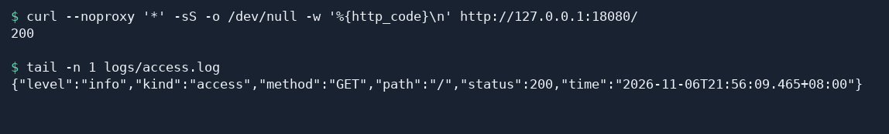

# 服务器其他默认配置项

访问日志可以告诉你客户端请求了哪个路径、服务器返回了什么状态码。Fast-Https v1.5.0 的访问日志默认写入 `logs/access.log`，一行是一条 JSON 记录。可以用 `http.log_format` 选择要记录的请求和响应字段。

## 1 选择要记录的字段

打开 `config/fast-https.json`，找到已有的 `http` 对象。把其中的 `log_format` 改成下面的值。如果原来没有这个字段，就把它加到同一个 `http` 对象中。下面的 JSON 只展示字段的位置，编辑时保留现有站点及其他配置。

```json
{
  "http": {
    "log_format": ["method", "path", "status"]
  }
}
```

保存文件后，Fast-Https 会在下次启动时读取配置。服务已在运行时，在可执行文件所在目录执行以下 Linux 命令重新加载配置。

```bash
./fast-https reload
```

## 2 发起请求并查看日志

向一个已运行的站点发出请求。下面使用 [配置网站通过 HTTPS 访问](/docs/使用教程/配置网站通过https访问/) 中的本地 HTTP 测试地址。使用其他站点时，替换成它的地址。

```bash
curl --noproxy '*' -sS -o /dev/null -w '%{http_code}\n' http://127.0.0.1:18080/
```

收到 `200` 后，从解压目录读取最新一条访问日志。如果在配置中指定了 `log_root`，到对应目录查看。

```bash
tail -n 1 logs/access.log
```

示例输出如下。时间随请求变化，`method`、`path` 和 `status` 对应刚才的请求。

```json
{"level":"info","kind":"access","method":"GET","path":"/","status":200,"time":"2026-11-06T07:27:07.851-05:00"}
```



## 3 可选字段

| 写在 `log_format` 中的名称 | 日志中记录的信息 |
| --- | --- |
| `ip_port` | 客户端的 IP 和端口，输出字段为 `remote_addr` |
| `time` | 记录时间 |
| `type` | 处理方式，例如静态文件 `LOCAL` |
| `method` | HTTP 方法，例如 `GET` |
| `path` | 请求路径 |
| `host` | 请求的 Host |
| `status` | 响应状态码 |
| `size` | 响应体大小，单位为字节 |
| `user_agent` | 客户端的 User-Agent |

省略 `log_format` 或将其设为空数组时，会使用表中这组默认字段。即使只选 `method`、`path` 和 `status`，日志仍会带有 `level`、`kind` 和 `time`。如果配置中包含 `log_split`，删除该字段。如果 `log_format` 数组中包含 `referer`，删除该条目。读取访问日志时，按 JSON 字段名取值。
