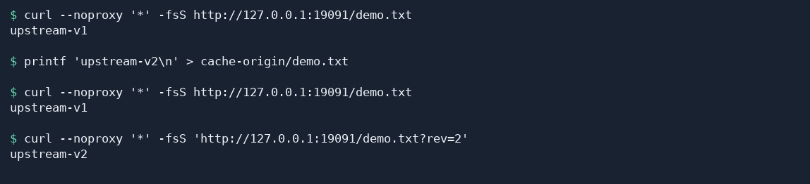

# 给反向代理站点配置缓存

本教程用一个本地文本文件演示缓存命中。先通过 Fast-Https 读取文件，再修改上游内容，就能对比缓存保留的副本和上游更新后的文件。

## 1 反向代理站点配置缓存的意义

为反向代理站点配置缓存，可以提高 Web 应用的性能、改善访问体验，并减轻高峰期的后端负载。接收代理转发请求的后端服务称为「上游」。启用缓存后，Fast-Https 会按配置保存符合条件的上游响应，供后续请求使用。

- **提高性能**。用户首次访问尚未缓存的资源时，Fast-Https 向上游请求内容，并按规则保存响应。后续访问命中缓存后，代理直接返回副本，可以减少发往上游的请求次数和响应等待时间。
- **减轻后端压力**。图片、CSS 文件和 JavaScript 文件等静态资源经常被重复请求。将这些资源交给代理从缓存提供，后端应用可以将更多 CPU 和连接资源用于登录、查询等动态请求。
- **节约带宽**。缓存副本保存在运行 Fast-Https 的代理服务器上。再次访问同一个资源并命中缓存时，代理把副本直接发给用户，省去资源从上游到代理的重复传输。
- **提高用户体验**。页面通常需要加载图片、样式和脚本。缩短这些资源的加载时间，可以减少浏览时的等待，使页面更快显示，访客也能更流畅地连续浏览多个页面。
- **增强系统稳定性**。访问高峰时，同一热门资源可能在短时间内被大量请求。代理可以从缓存直接响应重复访问，减少后端的负载波动。在使用多个后端的部署中，负载均衡将需要回源（向后端取响应）的请求分配给各台服务器，缓存减少重复回源。两者配合，有助于降低单台后端过载影响整个站点的风险。
- **支持资源更新**。通过 `valid` 设置缓存时长，可按资源的更新频率调整副本的保留时间。发布更新后的图片、CSS 或脚本时，可以为页面引用的 URL 设置版本参数，例如 `style.css?v=2`。如果缓存键包含查询参数，修改版本参数就会使用不同的缓存键。首次请求带有该参数值的 URL 时，可从上游获取更新后的资源。
- **保护后端入口**。如果部署时只向访客开放 Fast-Https 的入口，可以让上游只监听本机地址，或放在只允许代理访问的内网中。下文的上游就只监听 `127.0.0.1`。更新较少的公开资源还可以设置较长的缓存时长，在副本有效时减少访客请求传到上游的次数。

## 2 为反向代理站点启用缓存

已有反向代理站点时，把 `proxy_cache` 加到需要缓存的 `"type": "proxy"` 路由中，与 `proxy_pass` 同级。保存后重新加载配置。

### 2.1 准备本地上游

命令以 Linux（Ubuntu 为例）演示，需要 Python 3 和 `curl`。JSON 配置也适用于 Windows。下载与你的操作系统和处理器架构匹配的压缩包，解压到一个新的测试目录。接下来的命令从含有 `fast-https`、`config` 和 `httpdoc` 的解压目录运行。[Fast-Https v1.5.0 发行包](https://github.com/ncepu-iDealStudio/Fast-Https/releases/tag/v1.5.0)

在终端 A 中创建用于发布测试文件的目录。

```bash
mkdir cache-origin
```

写入测试文件。

```bash
printf 'upstream-v1\n' > cache-origin/demo.txt
```

启动上游。终端 A 保持运行。

```bash
python3 -m http.server 19090 --bind 127.0.0.1 --directory cache-origin
```

### 2.2 配置并启动反向代理

用下面的 JSON 替换**测试目录**中的 `config/fast-https.json`。Fast-Https 在 `19091` 接收请求，向 `19090` 上的 Python 服务取文件。

```json
{
  "http": {
    "server": [
      {
        "listen": 19091,
        "server_name": "localhost",
        "location": [
          {
            "url": "/",
            "type": "proxy",
            "proxy_pass": "http://127.0.0.1:19090",
            "proxy_cache": {
              "path": "cache-demo-store",
              "valid": ["200:5m"],
              "key": "$request_method$host$request_uri"
            }
          }
        ]
      }
    ]
  }
}
```

在终端 B 中进入同一个解压目录，启动 Fast-Https。

```bash
FASTHTTPS_FOREGROUND=1 ./fast-https start
```

终端 B 出现监听 `19091` 的日志后，在终端 C 中进入同一个解压目录，执行下一节的命令。

## 3 验证缓存命中

1. 请求代理上的文件。第一次返回 `upstream-v1`，Fast-Https 将这次成功响应写入缓存。

   ```bash
   curl --noproxy '*' -fsS http://127.0.0.1:19091/demo.txt
   ```

2. 等缓存写入后，在终端 C 更新上游文件。手动操作时，执行上一条命令后稍等一秒即可。

   ```bash
   printf 'upstream-v2\n' > cache-origin/demo.txt
   ```

3. 用同一个 URL 再请求一次。仍得到 `upstream-v1`，说明这次返回了之前的缓存。

   ```bash
   curl --noproxy '*' -fsS http://127.0.0.1:19091/demo.txt
   ```

4. 在 URL 后加上查询参数。请求 URI 变了，Fast-Https 使用新的缓存键，从上游取回 `upstream-v2`。

   ```bash
   curl --noproxy '*' -fsS 'http://127.0.0.1:19091/demo.txt?rev=2'
   ```



验证完成后，在终端 C 停止 Fast-Https，再到终端 A 按 `Ctrl+C` 停止 Python 服务。

```bash
./fast-https stop
```

## 4 为自己的站点选择缓存规则

| 字段 | 用途 |
| --- | --- |
| `path` | 缓存文件目录。为站点准备一个可写目录。 |
| `valid` | 按上游响应状态码设置缓存时长。示例 `"200:5m"` 表示缓存成功响应，时长为 5 分钟。 |
| `key` | 标识缓存副本。可按需组合 `$request_method`（请求方法）、`$host`（请求主机）和 `$request_uri`（请求路径及查询参数）。 |

`valid` 可以包含多条规则。例如，`["200:1h", "304:1h", "any:30m"]` 将 `200` 和 `304` 响应的缓存时长分别设为一小时，其余状态码使用 30 分钟。初次配置时，可以像本教程一样只缓存 `200` 响应。

示例使用的缓存键由访客共享，适合图片、样式表等所有访客都能访问的内容。
