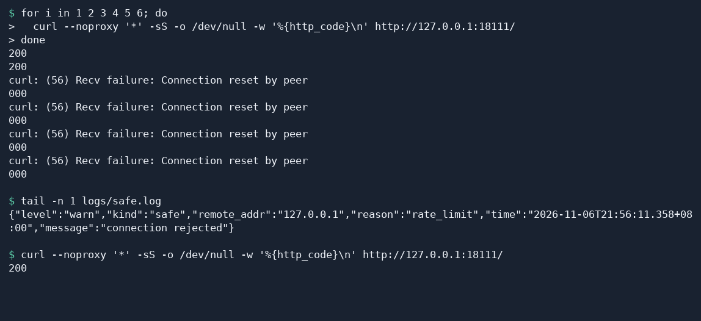

# 配置 Web 应用访问限流

本教程演示如何限制单个客户端 IP 的连接频率，并验证超过限制后的恢复过程。

## 1 为什么要配置访问限流

访问限流用于控制客户端在一定时间内能使用的服务资源。本教程使用 Fast-Https 的全局限流，按客户端 IP 限制新连接的频率和突发量，适合控制单个来源在短时间内建立过多连接的情况。

- **保护服务器资源**。处理大量新连接会占用 CPU、内存和网络资源。限制连接增长速度，可以减轻突发访问给服务器带来的压力。
- **提高服务质量**。高并发时，控制单个来源带来的负载，可以为后端保留处理能力，让服务在访问量上升时更稳定地响应。
- **缓解恶意流量**。短时间内反复建立连接会挤占正常访问的容量。按 IP 限制频率可约束单个攻击来源。面对分布式拒绝服务流量，各来源分别计算额度，整体防护还取决于网络和上游部署。
- **维护公平性**。每个客户端 IP 有自己的额度，可以限制脚本或反复重试的客户端所占用的容量，为其他来源保留访问机会。
- **控制成本**。对于按资源用量付费的服务，可以根据正常流量设置连接额度，减少异常连接激增带来的额外资源消耗。
- **优化用户体验**。流量高峰时，限制异常连接有助于减轻页面响应慢或服务暂时不可用的情况，访客更容易完成浏览和操作。
- **落实访问频率要求**。当站点有明确的连接频率或突发额度要求时，可将其落实为限流配置，并通过安全日志核对规则的生效情况。

## 2 配置测试站点

`http.servers_limit` 是实例级配置。v1.5.0 的全局限流按客户端 IP 在接受新连接时检查。测试循环每次运行 `curl` 都会创建新连接，便于观察限制。使用 HTTP/1.1 复用连接时，同一连接内的多个请求共用这一份连接额度。

下面在 Linux（Ubuntu 为例）用 `curl` 测试。JSON 配置也适用于 Windows。将与你的架构匹配的压缩包解压到新的测试目录，用下面的内容替换**测试目录**中的 `config/fast-https.json`。对已有实例，只需调整 `http.servers_limit`，保留站点及其他配置。[Fast-Https v1.5.0 发行包](https://github.com/ncepu-iDealStudio/Fast-Https/releases/tag/v1.5.0)

```json
{
  "http": {
    "servers_limit": {
      "limit": 1,
      "burst": 2
    },
    "server": [
      {
        "listen": 18111,
        "server_name": "localhost",
        "location": [
          {
            "url": "/",
            "type": "local",
            "root": "./httpdoc/root",
            "index": ["index.html"]
          }
        ]
      }
    ]
  }
}
```

在含有 `fast-https` 的解压目录启动测试站点。

```bash
FASTHTTPS_FOREGROUND=1 ./fast-https start
```

## 3 触发限制并确认恢复

看到 `18111` 的监听日志后，另开一个终端并进入同一个解压目录。快速连续访问六次，每次打印状态码。直接复制整个循环执行。

```bash
for i in 1 2 3 4 5 6; do
  curl --noproxy '*' -sS -o /dev/null -w '%{http_code}\n' http://127.0.0.1:18111/
done
```

突发额度用完前，测试请求返回 `200`。连续建立连接时，消耗额度的速度可能超过补充速度。使用 v1.5.0 Linux 发行包时，触发限制后连接可能被重置，`curl` 可能显示 `000` 和 `Connection reset by peer`。用安全日志中的 `"reason":"rate_limit"` 确认这次拒绝来自限流。

```bash
tail -n 1 logs/safe.log
```

等待至少两秒后，再发出一次请求。

```bash
curl --noproxy '*' -sS -o /dev/null -w '%{http_code}\n' http://127.0.0.1:18111/
```

再次看到 `200` 表示额度已恢复。同一 IP 可以继续访问。



验证完成后停止测试服务。

```bash
./fast-https stop
```

## 4 为实际服务设置额度

| `servers_limit` 字段 | 含义 | v1.5.0 发行包默认值 |
| --- | --- | --- |
| `limit` | 每个 IP 每秒补充的额度，`0` 表示关闭这项频率限制 | `0` |
| `burst` | 每个 IP 最多可积攒的额度。每个新连接消耗一份，启用限流时设置为正数 | `0` |
| `max_header_size` | 请求头大小上限，单位为字节 | `4096`（4 KiB） |
| `max_body_size` | 请求体大小上限，包含上传数据，单位为字节 | `524288`（512 KiB） |

示例的 `limit: 1` 和 `burst: 2` 让同一 IP 一开始可以快速建立两个连接，随后每秒恢复一份额度。配置实际服务时，以正常客户端的连接频率和允许的突发量为依据。请求体与请求头的大小限制可以分别调整。保存后重新加载配置。

频率限制会随额度恢复自动放行。需要持续拒绝指定地址时，使用 [IP 黑名单](/docs/使用教程/配置服务器访问ip黑名单/)。
