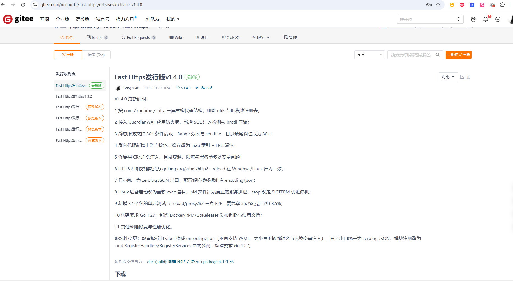
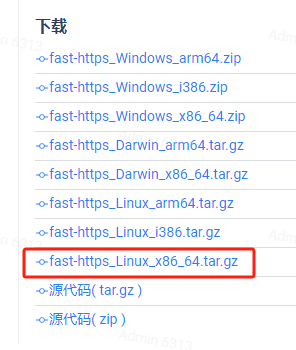
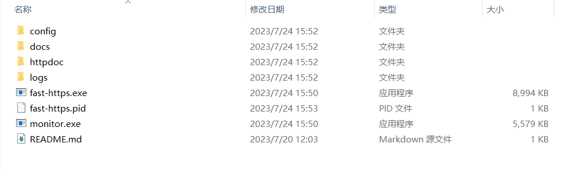
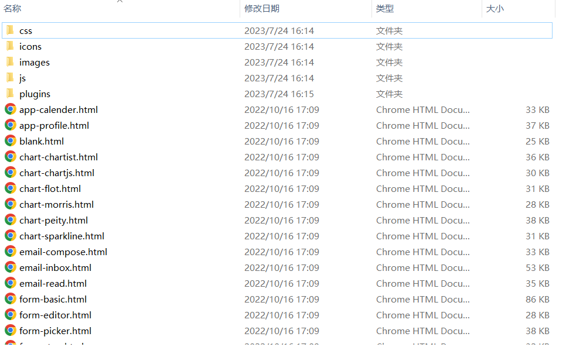
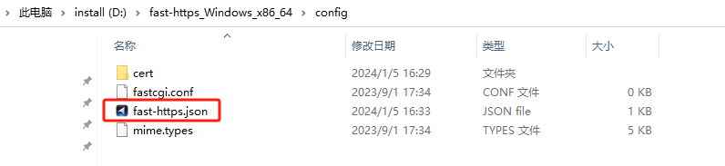
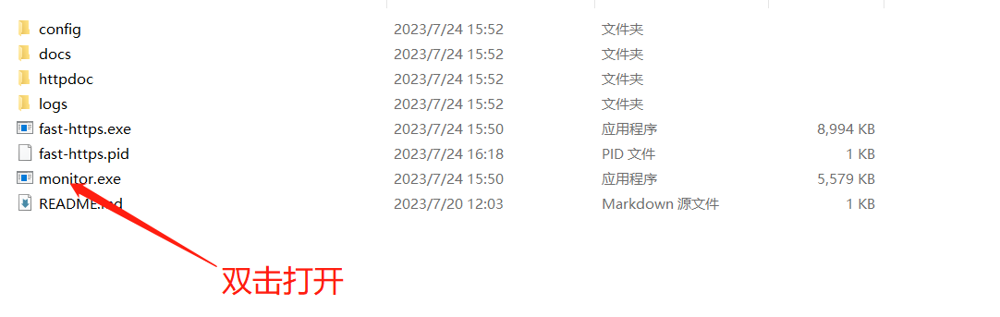
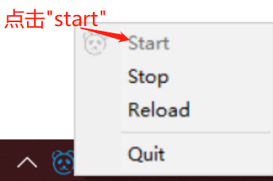
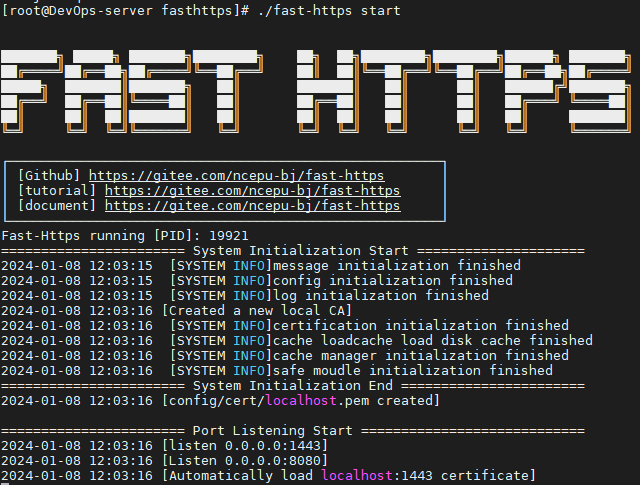

# 配置发布本地静态站点

本页以发布一个静态网站为例，说明 Fast-Https 在 Windows 与 Linux 两个平台上部署本地静态站点的完整过程。

## 1 软件获取

打开发行下载页确定部署平台：

<https://gitee.com/ncepu-bj/fast-https/releases>

- Windows 平台一般下载 `fast-https_Windows_x86_64.zip` 即可；
- Linux 平台按服务器 CPU 架构选择，普通 x86 架构服务器下载 `fast-https_Linux_x86_64.tar.gz`。





## 2 安装部署 - Windows 平台

### 软件包解压

下载完成后解压压缩包：



把解压后的目录拷贝到合适的位置，下面假定为 `D:\fast-https_Windows_x86_64`。

### 静态站点代码上传到服务器

在 `D:\fast-https_Windows_x86_64\httpdoc` 下创建站点文件夹，名称可以用域名，例如 `www.myweb.com`；然后把准备好的静态站点代码拷贝到 `D:\fast-https_Windows_x86_64\httpdoc\www.myweb.com` 中：



### 修改配置文件

在 `D:\fast-https_Windows_x86_64\config` 下找到主配置文件 `fast-https.json`：



按下述方式修改：

```json
{
  "log_root": "./logs",
  "pid": "./fast-https.pid",
  "http": {
    "include": "mime.types",
    "server": [
      {
        "listen": 8080,
        "server_name": "localhost",
        "location": [
          {
            "url": "/",
            "type": "local",
            "root": "./httpdoc/www.myweb.com",
            "index": ["index.html", "index.htm"]
          }
        ]
      },
      {
        "listen": "443 ssl",
        "server_name": "localhost",
        "ssl_certificate": "config/cert/localhost.pem",
        "ssl_certificate_key": "config/cert/localhost-key.pem",
        "location": [
          {
            "url": "/",
            "type": "local",
            "root": "./httpdoc/www.myweb.com",
            "index": ["index.html", "index.htm"]
          }
        ]
      }
    ]
  }
}
```

上面配置了两个站点块：8080 端口的明文站点与 443 端口的加密站点，二者指向同一个静态目录。

### 启动服务器管理程序

在 `D:\fast-https_Windows_x86_64` 中找到并双击 `monitor.exe`：



之后点击任务栏右下角的托盘图标启动服务：



浏览器访问 `http://localhost:8080` 即可看到站点页面：


### 用域名访问站点

把 `server_name` 改成你的域名：

```
"server_name": "www.myweb.com"
```

然后在 hosts 文件中添加一条本地解析（hosts 文件通常位于 `C:\Windows\System32\drivers\etc`）：

```
127.0.0.1 www.myweb.com
```

保存后即可通过 `http://www.myweb.com:8080` 访问网站。

## 3 Linux 平台安装部署

### 3.1 静态站点代码上传服务器

在 `/usr/local/fast-https/httpdoc/` 下创建站点文件夹 `www.myweb.com`，把静态站点代码拷贝到 `/usr/local/fast-https/httpdoc/www.myweb.com`：


### 3.2 修改配置文件

```bash
$ vi /usr/local/fast-https/config/fast-https.json
```

配置内容与 Windows 平台完全一致（见上一节），`root` 指向 `./httpdoc/www.myweb.com` 即可。

### 3.3 启动并测试

```bash
$ ./fast-https
```



这种方式在退出终端时会随会话一起终止，生产环境建议后台启动：

```bash
$ nohup ./fast-https &
```

浏览器访问 `http://ip:8080/index.html`，即可看到部署的静态站点：


<div class="admon">
<svg viewBox="0 0 24 24" fill="none" stroke="currentColor" stroke-width="2"><circle cx="12" cy="12" r="9"/><path d="M12 8v5M12 16h.01"/></svg>
<div>从远程浏览器访问服务器时，请把 <code>server_name</code> 改为服务器 IP 或已解析的域名；若 80/443 端口被占用，可先改用其他端口验证。</div>
</div>
