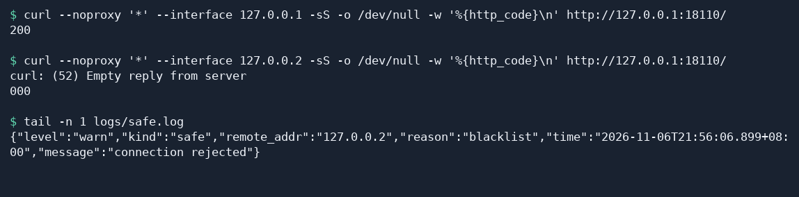
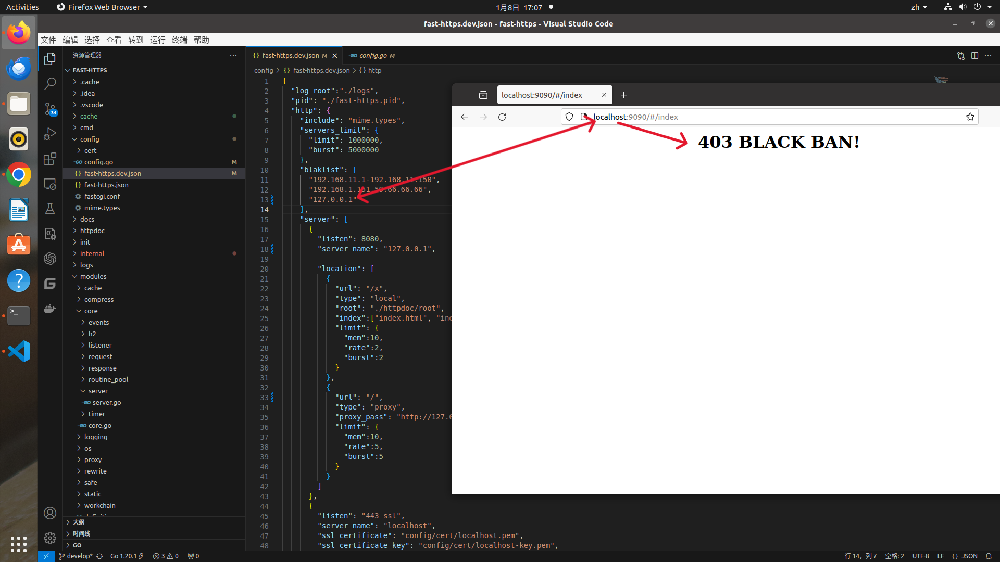

# 配置服务器访问 IP 黑名单

本教程介绍如何按客户端 IP 拒绝连接，并通过安全日志确认拦截结果。

## 1 为什么要设置 IP 黑名单

IP 黑名单是一种按来源地址管理访问的措施。Fast-Https 可以在把请求交给应用前，拒绝来自指定客户端 IP 的连接。它适合处理已经确认需要拦截的来源。

- **拦截已知的恶意访问**。识别出参与拒绝服务攻击、暴力登录或恶意代码注入尝试的来源后，可以把对应 IP 加入黑名单，阻止这些地址继续连接站点。
- **保护服务器资源**。异常访问会占用带宽、CPU 和内存。提前拒绝已知异常来源，可以减少应用为这些请求付出的处理和响应开销。
- **降低数据风险**。发现某个来源反复尝试未授权的数据读取或修改时，限制它继续连接可以减少后续尝试，配合身份验证和权限控制保护数据。
- **维护用户体验**。持续的异常访问可能挤占正常请求所需的容量。过滤已知来源后，可以为正常访问保留更多处理资源，降低页面变慢或暂时不可用的风险。
- **落实合规和访问管理要求**。如果站点的访问管理要求明确限制某些 IP 或网段，可以将对应地址配置为拒绝规则，并定期核对规则及适用范围。
- **简化日志分析**。可以在安全日志中按 `blacklist` 查找拦截事件，集中查看被拦截的地址，再排查其他需要关注的请求。
- **细化访问控制**。可以按单个 IP、多个 IP 或连续地址段配置，按需要将规则的影响范围限定到具体地址。
- **维护网站声誉**。持续的恶意活动可能干扰正常服务，降低用户对网站的信任。阻断已确认的恶意来源，可以减少这类活动持续影响访客的机会。

多个访客可能共用同一个出口 IP。添加规则前要核对影响范围，并定期检查是否需要保留条目。实际部署中，还可以结合防火墙的允许规则和入侵检测等措施管理访问。

## 2 配置 IP 黑名单

在 `config/fast-https.json` 的 `http` 对象内设置 `blaklist`。键名固定为 `blaklist`，规则作用于当前 Fast-Https 实例。Fast-Https 按接收到的连接来源 IP 匹配黑名单。如果流量先经过另一层代理，配置前先确认 Fast-Https 实际收到的来源 IP。

| 要拦截的地址 | `blaklist` 数组中的一个条目 |
| --- | --- |
| 单个 IP | `"192.0.2.10"` |
| 多个 IP | `"198.51.100.8,203.0.113.9"` |
| 连续 IP 段，包含两端 | `"192.0.2.30-192.0.2.40"` |

可以把多条规则放在同一个数组里。已有站点只需修改 `http.blaklist`，保存后重新加载配置。

## 3 在本机验证拦截

下面用 Linux（Ubuntu 为例）的两个回环地址模拟不同客户端，需要 `curl`。JSON 配置也适用于 Windows。将与你的架构匹配的压缩包解压到新的测试目录。用以下内容替换**测试目录**中的 `config/fast-https.json`，配置一个监听 `18110` 的欢迎页和一条拦截规则。[Fast-Https v1.5.0 发行包](https://github.com/ncepu-iDealStudio/Fast-Https/releases/tag/v1.5.0)

```json
{
  "http": {
    "blaklist": ["127.0.0.2"],
    "server": [
      {
        "listen": 18110,
        "server_name": "localhost",
        "location": [
          {
            "url": "/",
            "type": "local",
            "root": "./httpdoc/root",
            "index": ["index.html"]
          }
        ]
      }
    ]
  }
}
```

在含有 `fast-https` 的解压目录启动服务。

```bash
FASTHTTPS_FOREGROUND=1 ./fast-https start
```

看到 `18110` 的监听日志后，另开一个终端，进入同一个解压目录。从未被拦截的 `127.0.0.1` 发起访问，预期返回 `200`。

```bash
curl --noproxy '*' --interface 127.0.0.1 -sS -o /dev/null -w '%{http_code}\n' http://127.0.0.1:18110/
```

再从黑名单中的 `127.0.0.2` 访问同一个地址。`--interface` 只改变请求来源，目标仍是同一个站点。

```bash
curl --noproxy '*' --interface 127.0.0.2 -sS -o /dev/null -w '%{http_code}\n' http://127.0.0.1:18110/
```

v1.5.0 的 Linux 发行包命中黑名单时会关闭连接，`curl` 可能显示 `000` 并报告空响应。读取安全日志，确认连接被拦截的原因。

```bash
tail -n 1 logs/safe.log
```

确认这一行包含 `"remote_addr":"127.0.0.2"` 和 `"reason":"blacklist"`。



浏览器拦截提示如下（案例网站仅供测试）。



## 4 解除拦截

将测试配置的 `blaklist` 改为 `[]`，保存并在可输入命令的终端重新加载。

```bash
./fast-https reload
```

再次从 `127.0.0.2` 执行同一条 `curl` 命令，应该得到 `200`。验证完成后停止测试服务。

```bash
./fast-https stop
```
