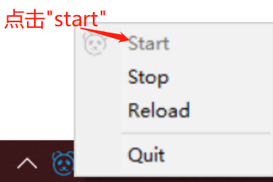

# 配置网站通过 HTTPS 访问

从 HTTP 到 HTTPS 只需要三步：启动服务、下载根证书、安装信任。本页先讲清 HTTP 与 HTTPS 的区别，再给出 Windows 平台的操作步骤。

## 1 什么是 HTTP 和 HTTPS

HTTP（超文本传输协议）是在万维网上传输和共享信息的基础网络技术，但它有明显的安全缺陷：未经授权的人员很容易进行攻击并窃取数据。HTTPS（安全超文本传输协议）是 HTTP 的第二代，让电子商务、网上银行、即时消息、视频聊天、文件传输、云存储等日常交易有了安全港。

### 1.1 SSL 协议使一切变得不同

HTTP 和 HTTPS 之间的关键区别在于 SSL 证书。SSL（安全套接字层）证书在 Web 服务器与浏览器之间发送或接收数据之前对数据加密，确保不会有恶意软件、病毒甚至安全威胁潜入最终用户的网络。

| 细节 | HTTP 协议 | HTTPS |
| --- | --- | --- |
| 网址 | 前缀 `http://` | 前缀 `https://` |
| 通信端口 | 80 | 443 |
| 安全 | 已证实存在安全问题 | 消除在线信息交换的威胁 |

### 1.2 HTTPS 迁移的迫切需求

- 搜索引擎已明确把 HTTPS 作为排名因素，HTTPS 网页更可能出现在搜索结果前列；
- 主流浏览器会把收集密码或信用卡的 HTTP 页面标记为「不安全」；
- 客户和用户把 HTTPS 视为对网站信任与安全的标志；
- HTTP/2 相比 HTTP/1.1 在所有浏览器上有显著的性能优化，而采用 HTTP/2 必须使用 HTTPS。

### 1.3 Web 应用使用 HTTPS 的好处

- **数据加密**：通过 SSL/TLS 对数据加密，敏感信息（用户名、密码、信用卡号）不会被第三方窃取或篡改；
- **身份验证**：通过数字证书验证服务器身份，避免钓鱼网站与中间人攻击；
- **保护数据完整性**：防止攻击者在传输途中修改内容；
- **提升用户信任**：地址栏的锁形图标与 HTTPS 前缀是信任的第一信号；
- **搜索引擎优化**：HTTPS 是搜索排名因素；
- **符合法律法规**：如 GDPR 等法规要求保护用户数据安全；
- **防止内容劫持**：避免被插入恶意广告或恶意软件；
- **适应未来标准**：HTTPS 已成为网络通信的默认标准。

## 2 配置 SSL 自签名证书

### 2.1 第一步　启动 Fast-Https 服务

点击任务栏右下角的托盘图标，启动本地 Web 服务：



### 2.2 根证书下载

浏览器访问 `http://localhost:8080/`，可以看到 Web 服务器的默认启动页面，点击页面上的 **Download Certificate** 下载根证书 `root.crt`。

### 2.3 证书安装（Windows 平台）

1. 在下载目录中找到 `root.crt`，双击开始安装；
2. 在导入向导中选择 **当前用户**；
3. 选择「将所有的证书都放入下列存储」，按向导依次点击「下一步」；
4. 出现「您即将安装来自证书颁发机构的证书」的安全警告时点击「确定」，看到「导入成功」即完成安装。

<div class="admon">
<svg viewBox="0 0 24 24" fill="none" stroke="currentColor" stroke-width="2"><circle cx="12" cy="12" r="9"/><path d="M12 8v5M12 16h.01"/></svg>
<div>自签名证书要让浏览器信任，必须把根证书装入系统信任存储；换机器或换浏览器（如 Firefox 使用独立存储）时需要重新导入。</div>
</div>

### 2.4 访问测试

浏览器访问：

```
https://localhost
```

地址栏出现锁形图标即表明证书已生效。

## 3 相关阅读

- 用 80 端口自动跳转到 HTTPS：[如何为网站配置重定向功能](/docs/使用教程/如何为网站配置重定向功能/)
- 站点加密配置块的写法：[基本配置](/docs/使用教程/基本配置/)
