# 配置网站通过 HTTPS 访问

本教程用 Fast-Https 发布本地测试站点，下载本地根证书并验证 HTTPS 连接。Windows 使用托盘菜单和证书导入向导，Linux 使用终端启动服务并验证连接。

## 1 什么是 HTTP 和 HTTPS

HTTP（超文本传输协议）是万维网上传输和共享信息的基础。浏览器访问网页时会发送 HTTP 请求，服务器用 HTTP 响应返回页面或其他数据。使用普通 HTTP 时，数据在传输途中可能被第三方读取或修改。

HTTPS（安全超文本传输协议）在 TLS 加密连接上使用 HTTP，为浏览器和服务器之间的数据传输提供保护。电子商务、网上银行、即时消息、视频聊天、文件传输和云存储等场景都需要保护用户信息。

### 1.1 TLS 加密与证书

TLS（传输层安全协议）承接了早期 SSL（安全套接字层协议）的用途，因此站点证书也常被称为「SSL 证书」。建立 HTTPS 连接时，浏览器会检查服务器提交的证书是否在有效期内、是否对应访问的域名，以及是否能追溯到受信任的证书颁发机构（CA）。通过校验后，TLS 会保护后续数据的传输，使中途监听的人难以读取数据，并让接收方能发现内容是否被篡改。[HTTP 规范](https://www.rfc-editor.org/rfc/rfc9110.html) · [TLS 规范](https://www.rfc-editor.org/rfc/rfc8446.html)

| 对照项 | HTTP | HTTPS |
| --- | --- | --- |
| 网址前缀 | `http://` | `https://` |
| 默认端口 | `80` | `443` |
| 传输保护 | 内容可被监听或篡改 | 通过 TLS 提供加密、服务器身份验证和完整性保护 |

站点可以使用其他端口。访问非默认端口时，要在网址中写出端口，例如 `https://localhost:18443/`。

### 1.2 为什么网站迁移到 HTTPS

- **搜索和页面体验**。Google 曾将 HTTPS 列为轻量的排名信号，页面体验指南也把 HTTPS 列为检查项。搜索结果的排序还取决于内容与查询的相关性等因素。[Google 搜索的 HTTPS 公告](https://developers.google.com/search/blog/2014/08/https-as-ranking-signal) · [页面体验指南](https://developers.google.com/search/docs/appearance/page-experience)
- **浏览器提示**。Chrome 56 开始将收集密码或信用卡信息的 HTTP 页面标为「不安全」。Firefox 也在未加密的登录表单中提示风险。[Chrome 的说明](https://security.googleblog.com/2016/09/moving-towards-more-secure-web.html) · [Firefox 的说明](https://blog.mozilla.org/security/2017/01/20/communicating-the-dangers-of-non-secure-http/)
- **交易和信息交换**。填写个人资料或付款信息时，用户可以查看浏览器的站点连接状态，再决定是否继续提交。
- **使用 HTTP/2**。HTTP/2 可以在一条连接上同时传输多组请求和响应，减少为了并行请求而额外建立的连接。实际性能取决于页面内容和网络条件。浏览器访问 HTTPS 站点时，可以在 TLS 握手中协商使用 HTTP/2。[HTTP/2 规范](https://www.rfc-editor.org/rfc/rfc9113.html)

### 1.3 Web 应用使用 HTTPS 的好处

- **加密数据**。保护传输中的用户名、密码、信用卡信息等敏感数据，降低被第三方读取的风险。
- **验证服务器身份**。通过数字证书核验所访问的域名，降低传输链路中的第三方冒充该站点的风险。识别使用相似域名的钓鱼页面时，还要核对地址栏中的实际域名。
- **保护数据完整性**。接收方可以发现传输中的内容是否被篡改。
- **让用户确认连接状态**。浏览器会在地址栏附近提供站点连接信息，用户可以在登录、购物或交换敏感信息时查看。[Chrome 站点信息图标说明](https://blog.chromium.org/2023/05/an-update-on-lock-icon.html)
- **支持搜索引擎优化（SEO）**。将站点入口统一到 HTTPS，配合重定向，可以帮助搜索引擎识别迁移后应使用的网址。[Google 搜索关于重定向的说明](https://developers.google.com/search/docs/crawling-indexing/301-redirects)
- **保护个人数据**。GDPR 第 32 条将加密列为可以根据风险采用的安全措施。HTTPS 可用于落实传输环节的数据保护。[GDPR 第 32 条](https://eur-lex.europa.eu/legal-content/EN/TXT/?uri=CELEX%3A02016R0679-20160504)
- **降低内容劫持风险**。保护传输链路，减少网页被替换或途中插入广告、恶意脚本的风险。
- **适应现代 Web 部署**。HTTPS 是现代网站提供加密连接的常用方式，可以作为新站点的默认访问方式。

## 2 配置本地 HTTPS

从 Fast-Https v1.5.0 发行页按操作系统选择压缩包。Windows x86_64 下载 `fast-https_Windows_x86_64.zip`，Linux x86_64 下载 `fast-https_Linux_x86_64.tar.gz`。解压到新的可写目录。Windows 解压目录中有 `monitor.exe`、`fast-https.exe`、`config` 和 `httpdoc`。Linux 解压目录中有 `fast-https`、`config` 和 `httpdoc`。[Fast-Https v1.5.0 发行包](https://github.com/ncepu-iDealStudio/Fast-Https/releases/tag/v1.5.0)

下面的配置用两个端口提供同一个测试首页。HTTP 端口供下载根证书，HTTPS 端口供验证加密访问。先确认测试所需的端口空闲。

| 操作系统 | HTTP 首页 | HTTPS 首页 |
| --- | --- | --- |
| Windows | `http://localhost:8080/` | `https://localhost/` |
| Linux | `http://localhost:18080/` | `https://localhost:18443/` |

在解压目录中打开 `config/fast-https.json`，用下面的 JSON 替换整个文件。示例使用 Linux 端口。在 Windows 上，将 `18080` 改为 `8080`，将 `"18443 ssl"` 改为 `"443 ssl"`。编辑完成后保存文件。

```json
{
  "http": {
    "server": [
      {
        "listen": 18080,
        "server_name": "localhost",
        "location": [
          {
            "url": "/",
            "type": "local",
            "root": "./httpdoc/root",
            "index": ["index.html"]
          }
        ]
      },
      {
        "listen": "18443 ssl",
        "server_name": "localhost",
        "ssl_certificate": "config/cert/localhost.pem",
        "ssl_certificate_key": "config/cert/localhost-key.pem",
        "location": [
          {
            "url": "/",
            "type": "local",
            "root": "./httpdoc/root",
            "index": ["index.html"]
          }
        ]
      }
    ]
  }
}
```

首次启动时，Fast-Https 会生成本地根证书 `httpdoc/root/root.crt`，并为 `localhost` 生成站点证书和私钥。站点证书和私钥由服务器使用，根证书供浏览器或 `curl` 验证该站点的证书。

## 3 在 Windows 上启动并验证

### 3.1 启动 Fast-Https

运行解压目录中的 `monitor.exe`。在任务栏通知区域右键单击 Fast-Https 图标，选择 **Start**。

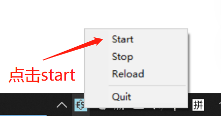

### 3.2 下载根证书

在浏览器打开 `http://localhost:8080/`。看到 Fast-Https 欢迎页后，点击 **Download Certificate**，将根证书 `root.crt` 保存到下载目录。

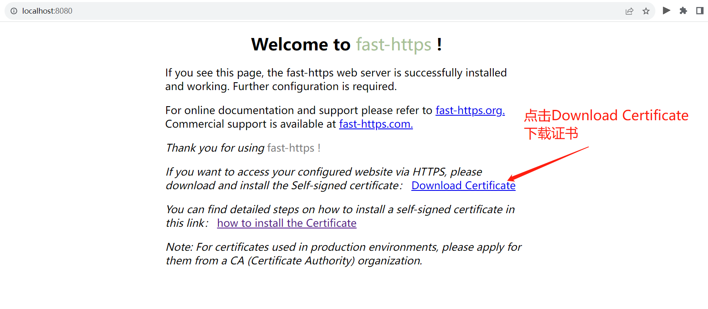

### 3.3 将根证书导入当前用户的证书存储

1. 在下载目录打开 `root.crt`，选择 **安装证书**。

   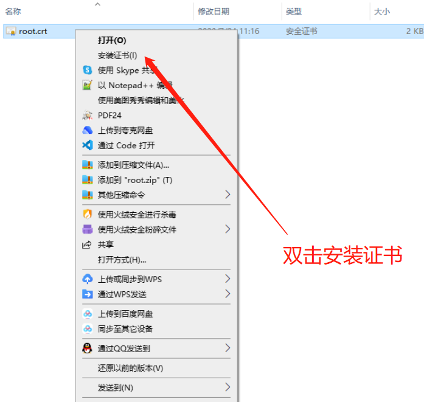

2. 在证书导入向导中选择 **当前用户**，点击 **下一步**。

   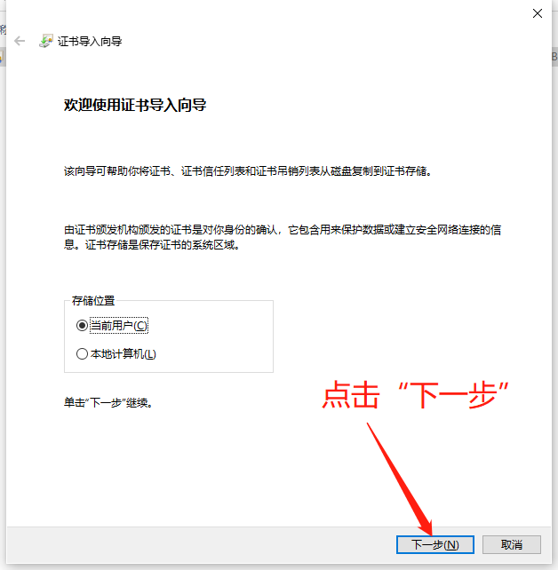

3. 选择 **将所有的证书都放入下列存储**，点击 **浏览**，选中 **受信任的根证书颁发机构**，再点击 **确定** 和 **下一步**。

   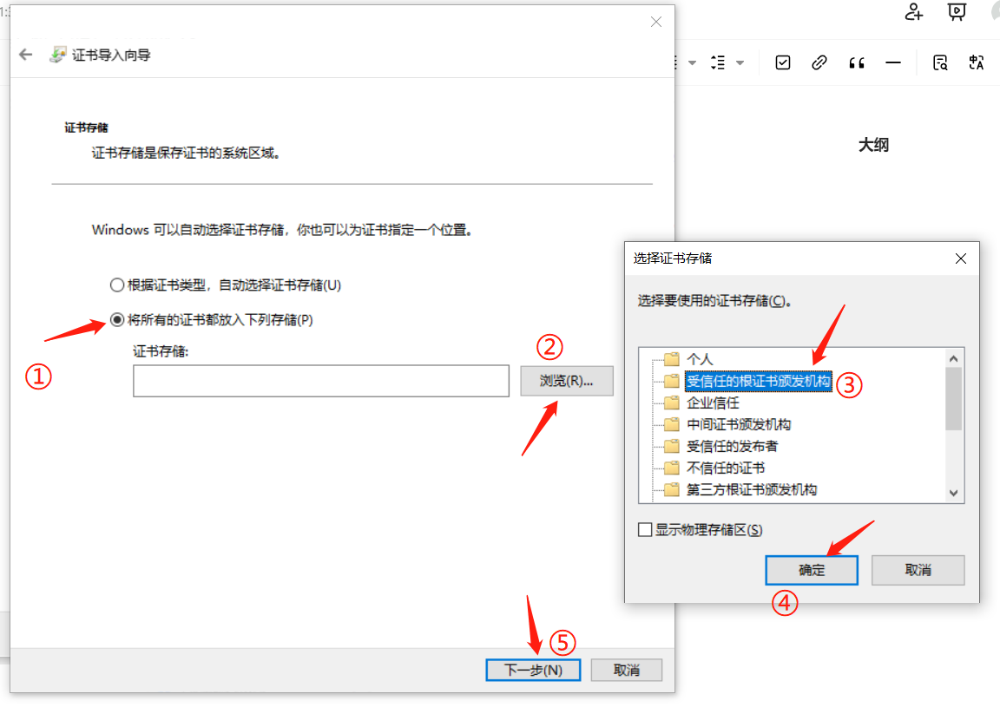

4. 在确认页面检查所选的证书存储，然后点击 **完成**。

   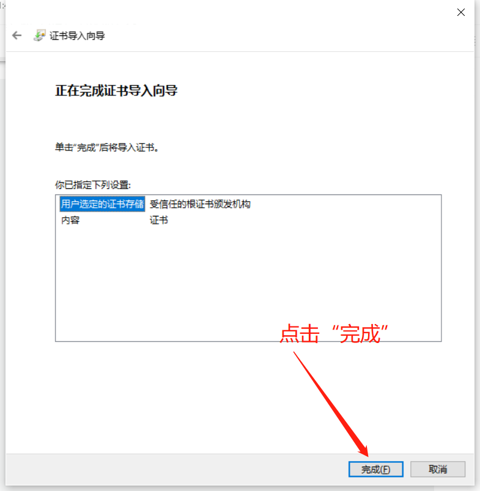

5. 如果出现安全警告，确认文件是刚从本机测试服务下载的 `root.crt`，再点击 **是**。看到 **导入成功** 后点击 **确定**。

   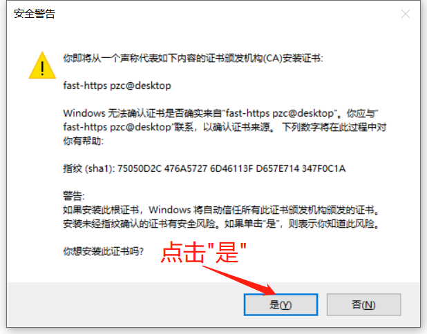

   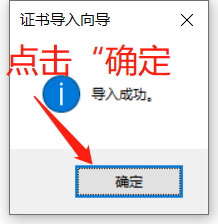

### 3.4 访问测试

在浏览器打开 `https://localhost/`，点击地址栏左侧的站点信息，确认连接状态显示为安全。下图展示了证书生效后的连接状态（案例网站仅供测试验证）。使用发行包自带的首页时，打开的是 Fast-Https 欢迎页。

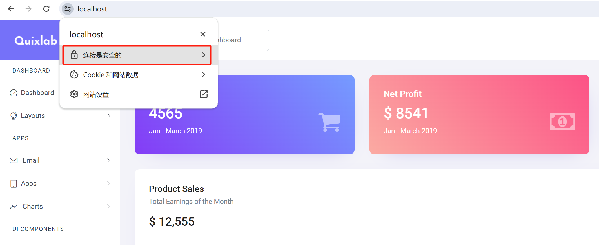

测试完成后，可在托盘菜单中选择 **Stop** 停止服务。

## 4 在 Linux 上启动并验证

以下命令以 Ubuntu 为例。运行前先准备好 `curl`，并将终端的工作目录切换到包含 `fast-https` 的解压目录。

### 4.1 启动 Fast-Https

在第一个终端前台启动服务。

```bash
FASTHTTPS_FOREGROUND=1 ./fast-https start
```

看到 `18080` 和 `18443` 的监听日志后，让服务继续运行。另开一个终端，进入同一个解压目录。

### 4.2 下载根证书

从 HTTP 测试站点下载根证书，保存为当前目录下的 `test-root.crt`。下面两行是同一条命令。

```bash
curl --noproxy '*' -fsS -o test-root.crt \
  -w 'CA download %{http_code}\n' http://localhost:18080/root.crt
```

看到 `CA download 200` 表示下载成功。

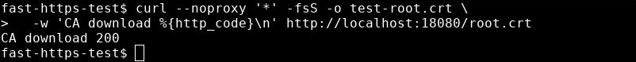

### 4.3 验证 HTTPS

使用 `--cacert` 指定刚下载的根证书，检查站点证书并请求 HTTPS 首页。

```bash
curl --noproxy '*' --cacert test-root.crt -fsS -o /dev/null \
  -w 'HTTP %{http_code}\nTLS verify %{ssl_verify_result}\n' https://localhost:18443/
```

`HTTP 200` 表示首页请求成功，`TLS verify 0` 表示证书校验通过。`--cacert` 指定的根证书仅用于本次 `curl` 请求。

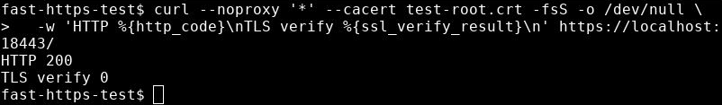

### 4.4 在浏览器查看测试站点

要在浏览器查看效果，先将本地的 `test-root.crt` 导入浏览器使用的受信任根证书存储。以 Chromium 为例，可在地址栏打开 `chrome://settings/certificates` 进入证书管理。[Chromium 的证书管理说明](https://chromium.googlesource.com/chromium/src/+/master/docs/linux/cert_management.md)

访问 `https://localhost:18443/`，打开地址栏左侧的站点信息。下图中的 **Connection is secure** 和 **Certificate is valid** 表示连接安全、证书有效，右侧显示 Fast-Https 欢迎页。

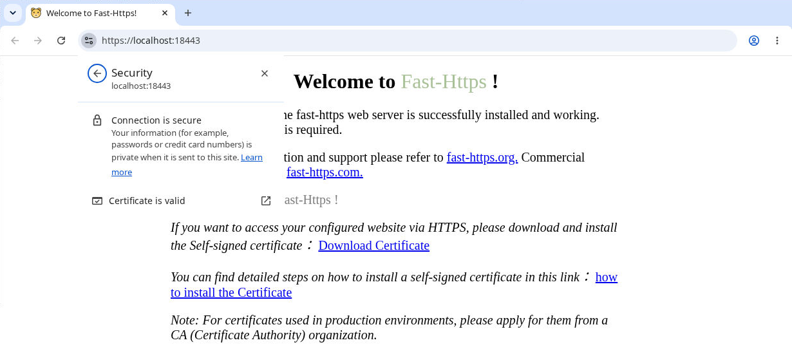

测试结束后，在第二个终端停止服务。

```bash
./fast-https stop
```

## 5 用于正式站点

将 `server_name` 改为站点的实际域名，将 `ssl_certificate` 和 `ssl_certificate_key` 指向受客户端信任、覆盖该域名的站点证书及其对应私钥。使用 HTTPS 默认端口时，将 HTTPS 站点的 `listen` 设为 `"443 ssl"`。

- 需要让 HTTP 入口跳转到 HTTPS 时，参阅[如何为网站配置重定向功能](/docs/使用教程/如何为网站配置重定向功能/)。
- 需要了解站点配置结构时，参阅[基本配置](/docs/使用教程/基本配置/)。
