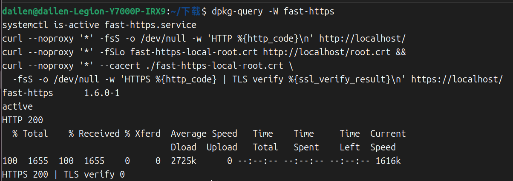
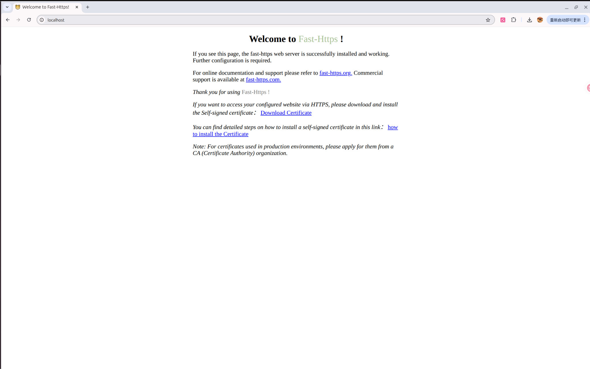

# Ubuntu 安装与部署

本页以 Ubuntu 24.04.4 LTS（amd64）全新安装 Fast-Https v1.6.0 为例。需要有 `sudo` 权限的账号。

## 1 下载服务端安装包

查询系统架构。

```bash
dpkg --print-architecture
```

根据输出选择服务端 `.deb` 包。`fast-https-desktop` 开头的包用于安装桌面界面。

| 系统架构 | 服务端安装包 | 下载 |
| --- | --- | --- |
| `amd64` | `fast-https_1.6.0_linux_amd64.deb` | [Gitee](https://gitee.com/ncepu-bj/fast-https/releases/download/v1.6.0/fast-https_1.6.0_linux_amd64.deb) / [GitHub](https://github.com/ncepu-iDealStudio/Fast-Https/releases/download/v1.6.0/fast-https_1.6.0_linux_amd64.deb) |
| `arm64` | `fast-https_1.6.0_linux_arm64.deb` | [Gitee](https://gitee.com/ncepu-bj/fast-https/releases/download/v1.6.0/fast-https_1.6.0_linux_arm64.deb) / [GitHub](https://github.com/ncepu-iDealStudio/Fast-Https/releases/download/v1.6.0/fast-https_1.6.0_linux_arm64.deb) |

## 2 安装并确认版本

在终端进入安装包所在目录，执行安装。若系统架构为 `arm64`，把命令中的文件名换成上表的 `arm64` 安装包文件名。

```bash
sudo apt install ./fast-https_1.6.0_linux_amd64.deb
dpkg-query -W fast-https
```

查询结果应显示 `fast-https` 和软件包版本 `1.6.0-1`。

| 用途 | 安装位置 |
| --- | --- |
| 命令 | `/usr/bin/fast-https` |
| 主配置 | `/etc/fast-https/fast-https.json` |
| 默认站点配置 | `/etc/fast-https/conf.d/default.json` |
| 默认站点目录 | `/usr/share/fast-https/httpdoc/root/` |
| 证书目录 | `/etc/fast-https/cert/` |
| 日志目录 | `/var/log/fast-https/` |

## 3 启动服务

默认站点使用 80（HTTP）和 443（HTTPS）端口。启动前查询这两个端口是否已有服务在监听。

```bash
ss -ltn '( sport = :80 or sport = :443 )'
```

如果输出只有表头，可以使用默认配置。如果端口已被占用，编辑 `/etc/fast-https/conf.d/default.json`，将 `listen` 改为可用端口，例如 `[18080, "18443 ssl h2"]`。验证时相应使用 `http://localhost:18080/` 和 `https://localhost:18443/`。

安装包已注册 systemd 服务。执行以下命令启动服务，状态应显示 `active`。

```bash
sudo systemctl start fast-https.service
systemctl is-active fast-https.service
```

## 4 验证默认站点

请求本机的 HTTP 首页，应得到 `HTTP 200`。

```bash
curl --noproxy '*' -fsS -o /dev/null -w 'HTTP %{http_code}\n' http://localhost/
```

首次启动会为 `localhost` 生成由本地 CA 签发的证书。下载 CA 证书，再用 `curl --cacert` 校验本次 HTTPS 请求的服务端证书。

```bash
curl --noproxy '*' -fSLo fast-https-local-root.crt http://localhost/root.crt &&
curl --noproxy '*' --cacert ./fast-https-local-root.crt \
  -fsS -o /dev/null -w 'HTTPS %{http_code} | TLS verify %{ssl_verify_result}\n' https://localhost/
```

`HTTPS 200 | TLS verify 0` 表示首页返回成功且证书校验通过。



在浏览器打开 `http://localhost/`，可查看 Fast-Https 默认首页。



## 5 管理服务

仅做本机测试时，验证结束后可停止服务。

```bash
sudo systemctl stop fast-https.service
```

开机自启、重启和日志查询见 [以服务方式启动](../以服务方式启动/)。

需要移除软件包并保留配置、证书和日志时，执行以下命令。

```bash
sudo apt remove fast-https
```

对外部署时，将 `server_name` 配置为实际访问的域名或 IP，并在防火墙和云平台安全组中按需放行监听端口。使用 HTTPS 时，为访问地址配置匹配的证书。
