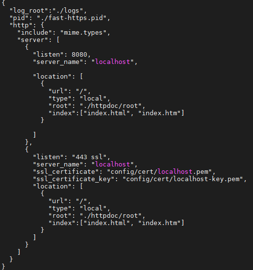
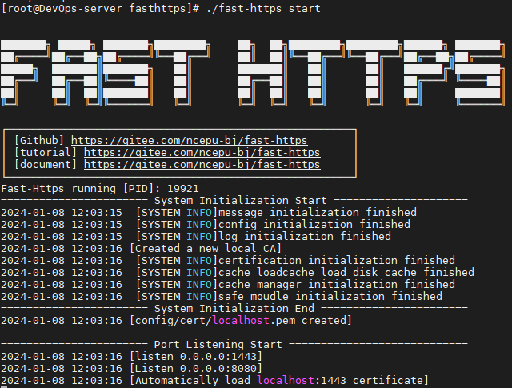
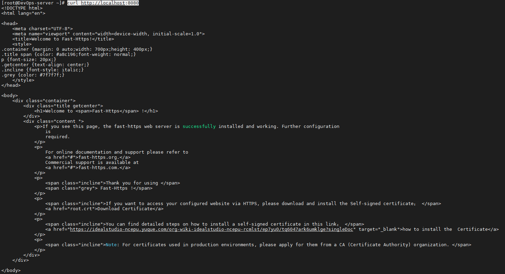

本页使用 CentOS 7.9 和 Fast-Https v1.0 的 `.tar.gz` 归档包演示解压部署。使用 `.deb` 服务端安装包的步骤见 [Ubuntu 安装与部署](../ubuntu/)。

```bash
# 创建软件目录
$ mkdir /soft
$ cd /soft

# 下载对应版本
$ wget https://gitee.com/ncepu-bj/fast-https/releases/download/v1.0/fast-https_Linux_x86_64.tar.gz

# 解压到安装目录
$ tar -xzvf fast-https_Linux_x86_64.tar.gz -C /usr/local/fasthttps
$ cd /usr/local/fasthttps/
$ chmod 755 ./fast-https
```

查看配置文件：

```bash
$ cat ./config/fast-https.json
```



<div class="admon">
<svg viewBox="0 0 24 24" fill="none" stroke="currentColor" stroke-width="2"><circle cx="12" cy="12" r="9"/><path d="M12 8v5M12 16h.01"/></svg>
<div>如果从远程浏览器访问服务器，请把 <code>server_name</code> 改为服务器 IP，例如 <code>"server_name": "192.168.11.166"</code>。为避免端口冲突，示例中已将 443 改为 1443（可保持 443）。</div>
</div>

服务器启动：

```bash
$ ./fast-https
```



生产环境建议后台运行：

```bash
$ nohup ./fast-https &
```

测试默认站点：

```bash
$ curl http://localhost:8080
```



在浏览器输入 `http://ip:8080/index.html` 即可看到默认启动页面，至此 CentOS 上的安装完成。
