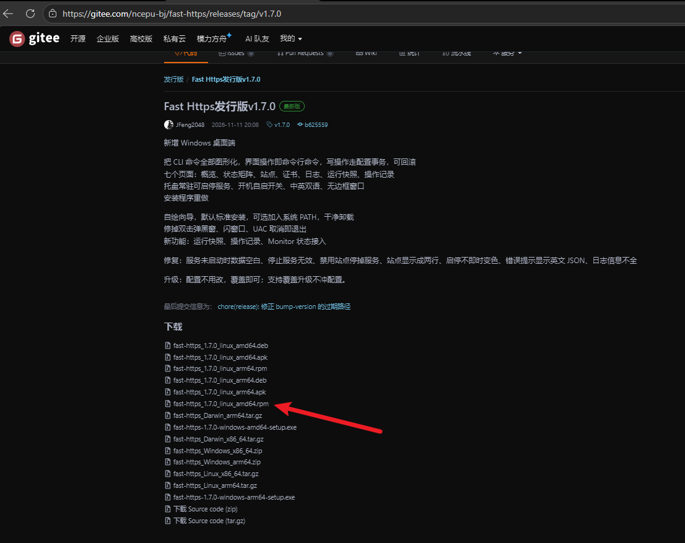
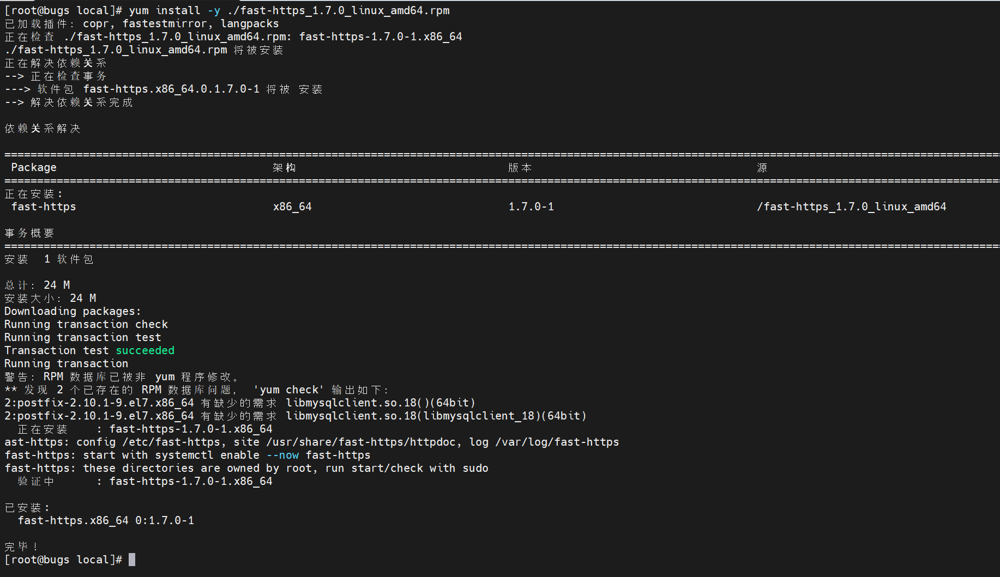
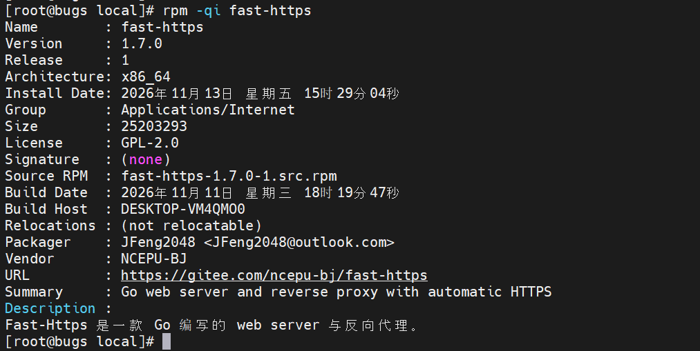
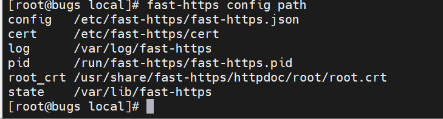
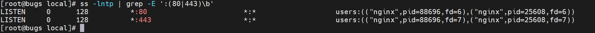
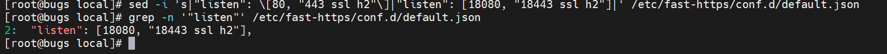
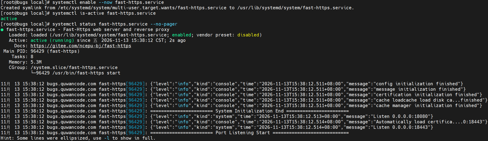
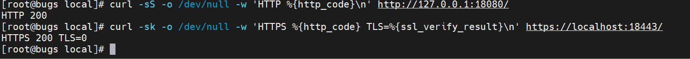

# CentOS 7 安装与部署

本页介绍在 CentOS 等使用 `yum` 的发行版上，用 `.rpm` 安装包部署 Fast-Https。安装后会自动注册系统服务，可以实现开机自启和异常自动重启。其他方式见 [Ubuntu 安装与部署](../ubuntu/) 与 [解压部署](../压缩包部署/)。

## 开始前

- 所有命令都在**服务器的终端**里执行，并且需要管理员权限。用 `root` 登录即可；如果不是 root，请在每条命令前加 `sudo`。
- 默认站点占用 **80 和 443** 端口。云服务器请先到控制台放行这两个端口，并确认没有被其他程序占用。
- 安装包从 [Gitee Releases](https://gitee.com/ncepu-bj/fast-https/releases) 或 [GitHub Releases](https://github.com/ncepu-iDealStudio/Fast-Https/releases) 下载。文档里不写版本号，请到发行页自己选最新版，避免版本更新后文档里的链接变成旧版。

**关于下面的「预期输出」**：每一步的输出都来自一次完整实测。那台服务器的 80 端口已被另一个站点占用，所以实测时按第 3 步的方法把 `listen` 改成了 `18080` / `18443`，示例里的验证地址也用了这两个端口。如果你的 80 / 443 空闲，把端口号换回默认值即可，输出形态完全相同。

## 1 确认架构并下载安装包

`.rpm` 是 CentOS / RHEL 系发行版的软件包格式。不同处理器要用不同的包，先查架构：

```bash
# 查看处理器架构
uname -m
```

**预期输出**

```text
x86_64
```

`x86_64` 对应文件名含 `amd64` 的包；输出 `aarch64` 则选 `arm64` 包。

**下载链接请自己到发行页取**，文档里不写版本号，这样版本更新后也不会在这里留下一个过期的链接：



图中红箭头指的是 `amd64` 包，`aarch64` 机器改选 `arm64` 结尾的那个；版本号以页面最上面一条 release 为准。

1. 在浏览器打开 [Gitee Releases](https://gitee.com/ncepu-bj/fast-https/releases) 或 [GitHub Releases](https://github.com/ncepu-iDealStudio/Fast-Https/releases)，找到**最上面一条** release，展开它的附件列表。
2. 按架构挑**服务端** `.rpm` 包：`x86_64` 选文件名含 `amd64` 的，`aarch64` 选含 `arm64` 的。不要选 `fast-https-desktop` 开头的桌面版。
3. 在该附件的下载按钮上**右键 → 复制链接地址**。
4. 回到服务器终端，把下面命令引号里的地址整个换成刚复制的链接，然后执行：

```bash
# 下载安装包并统一命名
wget -O fast-https.rpm '在这里粘贴复制到的下载链接'
# 确认安装包已下载及大小
ls -lh fast-https.rpm
```

`-O fast-https.rpm` 会把下载到的文件统一命名成 `fast-https.rpm`，后面所有命令都用这个名字，所以**整篇文档不需要你改任何版本号**。单引号不要省略，链接里可能含特殊字符。

**预期输出**（`wget` 的进度条已省略，只列 `ls` 打印的一行）

```text
-rw-r--r-- 1 root root 6.5M Nov 10 19:52 fast-https.rpm
```

看到文件名和大小就表示下载成功。如果你习惯在自己电脑上点下载，也可以用 `scp` 或 FTP 工具把安装包传到服务器当前目录，再改名为 `fast-https.rpm`，效果一样。

## 2 安装

```bash
# 安装 .rpm 包
yum install -y ./fast-https.rpm
# 查看已安装包的详细信息
rpm -qi fast-https
```

`-y` 表示自动确认安装提示，`./` 表示「当前目录里的这个文件」。`yum` 会自动补上 `ca-certificates` 和 `logrotate` 两个依赖。

**预期输出**（`yum` 末尾节选）

```text
Running transaction
fast-https: config /etc/fast-https, site /usr/share/fast-https/httpdoc, log /var/log/fast-https
fast-https: start with systemctl enable --now fast-https
fast-https: these directories are owned by root, run start/check with sudo
  Verifying  : fast-https-1.6.0-1.x86_64                                    1/1

Installed:
  fast-https.x86_64 0:1.6.0-1

Complete!
```



截图里用的是发行页的原始文件名；按上面的 `-O` 重命名为 `fast-https.rpm` 后，输出形态相同。

`Complete!` 表示安装结束；三行 `fast-https:` 是安装脚本打印的路径与启动建议。`rpm -qi` 的输出开头是：

```text
Name        : fast-https
Version     : 1.6.0
Release     : 1
Architecture: x86_64
Group       : Applications/Internet
Size        : 17292444
License     : GPL-2.0
```



能看到包名和架构就说明装好了。输出里的版本号只是实测时用的那个包，你从发行页下载的版本不同，这里的数字也会不同，不必一致。

安装后的文件位置（以后改配置、找日志会用到）：

| 用途 | 路径 |
| --- | --- |
| 命令 | `/usr/bin/fast-https` |
| 主配置 | `/etc/fast-https/fast-https.json` |
| 站点配置 | `/etc/fast-https/conf.d/default.json` |
| 默认站点目录 | `/usr/share/fast-https/httpdoc/root/` |
| 证书 | `/etc/fast-https/cert/` |
| 日志 | `/var/log/fast-https/` |
| pid 文件 | `/run/fast-https/fast-https.pid` |
| systemd 单元 | `/usr/lib/systemd/system/fast-https.service` |

`pid 文件`记录服务进程号，`systemd 单元`是服务的配置文本。用 `fast-https config path` 可以随时打印这些路径的实际位置：

```bash
# 查看程序实际读取的配置路径
fast-https config path
```

**预期输出**

```text
config /etc/fast-https/fast-https.json
cert   /etc/fast-https/cert
log    /var/log/fast-https
pid    /run/fast-https/fast-https.pid
```



新版本还会多打印 `root_crt`、`state` 两行，属于新增路径；版本不同行数可能不一样，其余路径含义不变。

## 3 启动并设置开机自启

先检查 80 / 443 有没有被占用：

```bash
# 检查 80/443 是否被占用
ss -lntp | grep -E ':(80|443)\b'
```

**预期输出（端口被占用时）**

```text
LISTEN     0      511          *:80    *:*    users:(("nginx",pid=7677,fd=8),...)
LISTEN     0      511       [::]:80 [::]:*   users:(("nginx",pid=7677,fd=9),...)
```



没有任何输出表示端口空闲；像上面这样列出进程名（这里是 nginx）表示被占用。此时不要停掉别人的服务，改自己的配置即可：编辑 `/etc/fast-https/conf.d/default.json`，把 `listen` 从 `[80, "443 ssl h2"]` 改成空闲端口，例如：

```bash
# 把默认端口改成 18080/18443
sed -i 's|"listen": \[80, "443 ssl h2"\]|"listen": [18080, "18443 ssl h2"]|' /etc/fast-https/conf.d/default.json
# 确认端口修改已生效
grep -n '"listen"' /etc/fast-https/conf.d/default.json
```

**预期输出**

```text
2:  "listen": [18080, "18443 ssl h2"],
```



后面所有验证地址都要换成这两个端口。若端口本来就空闲，跳过这一段，直接用默认的 80 / 443。

安装包已经注册了名为 `fast-https.service` 的 **systemd 服务**。systemd 是 Linux 管理后台服务的组件，`systemctl` 是操作它的命令。

```bash
# 启动并设置开机自启
systemctl enable --now fast-https.service
# 确认服务正在运行
systemctl is-active fast-https.service
# 查看服务运行状态
systemctl status fast-https.service --no-pager
```

**预期输出**

```text
Created symlink from /etc/systemd/system/multi-user.target.wants/fast-https.service to /usr/lib/systemd/system/fast-https.service.
active
● fast-https.service - Fast-Https web server and reverse proxy
   Loaded: loaded (/usr/lib/systemd/system/fast-https.service; enabled; vendor preset: disabled)
   Active: active (running)
 Main PID: 8395 (fast-https)
   CGroup: /system.slice/fast-https.service
           └─8395 /usr/bin/fast-https start
```



`Created symlink` 表示已设为开机自启；`active` 表示服务正在运行；`status` 里的 `Main PID` 是进程号，每次启动都不同。

单元里已经配置了 `Restart=on-failure`（异常退出后自动重启）、`RestartSec=2s` 和 `ExecReload=/usr/bin/fast-https reload`，这些不需要手动设置。

## 4 验证默认站点

```bash
# 验证 HTTP 是否返回 200
curl -sS -o /dev/null -w 'HTTP %{http_code}\n' http://127.0.0.1:18080/
# 验证 HTTPS（跳过自签证书校验）
curl -sk -o /dev/null -w 'HTTPS %{http_code} TLS=%{ssl_verify_result}\n' https://localhost:18443/
```

**预期输出**

```text
HTTP 200
HTTPS 200 TLS=0
```



`200` 是「请求成功」的状态码；`-k` 表示跳过自签名证书的校验，`TLS=0` 表示 TLS 连接本身正常。端口空闲时把地址换回 `http://127.0.0.1/` 和 `https://localhost/`。

也可以看端口是否真的在监听：

```bash
# 查看服务实际监听的端口
ss -lntp | grep -E ':(18080|18443)\b'
```

**预期输出**

```text
LISTEN   0   4096   [::]:18443   [::]:*   users:(("fast-https",pid=8395,fd=12))
LISTEN   0   4096   [::]:18080   [::]:*   users:(("fast-https",pid=8395,fd=11))
```

服务日志可用 `journalctl -u fast-https.service -n 30 --no-pager` 查看，其中会有这样的访问记录：

```text
{"level":"info","kind":"access","remote_addr":"127.0.0.1:51554","type":"LOCAL","method":"GET","path":"/","host":"127.0.0.1:18080","status":200,"size":2106,"user_agent":"curl/7.29.0"}
```

`status":200` 与前面的 curl 结果一致，说明请求确实打到了 Fast-Https。结构化日志也写在 `/var/log/fast-https/` 下。

如果服务器在云上，在你自己电脑的浏览器里打开 `http://<服务器公网 IP>:18080/`（用默认端口时不用带端口号）；`localhost` 只指服务器本机，不能在你的电脑上用。浏览器打开 HTTPS 时出现「证书不受信任」是正常现象，正式对外服务应配置与域名匹配的证书。

## 5 管理服务

安装包已注册 `fast-https.service`，日常用 `systemctl` 管理：

```bash
# 启动服务
systemctl start fast-https.service
# 启动并设置开机自启
systemctl enable --now fast-https.service
# 确认服务正在运行
systemctl is-active fast-https.service
# 查看服务运行状态
systemctl status fast-https.service --no-pager
# 修改配置后重启
systemctl restart fast-https.service
# 重新加载配置
fast-https reload
# 查看最近的服务日志
journalctl -u fast-https.service -n 30 --no-pager
# 停止并取消开机自启
systemctl disable --now fast-https.service
```

几个关键命令的输出：`fast-https reload` 与 `systemctl restart` 正常时**没有任何输出**，用 `systemctl is-active fast-https.service` 复查会打印 `active`。`disable --now` 的输出是：

```text
Removed symlink /etc/systemd/system/multi-user.target.wants/fast-https.service.
```

此时再执行 `is-active` 会返回 `unknown`（或 `inactive`），都表示服务已停止。

需要卸载时：

```bash
# 卸载软件包
yum remove -y fast-https
```

**预期输出**（末尾节选）

```text
  Erasing    : fast-https-1.6.0-1.x86_64                                    1/1
warning: /etc/fast-https/conf.d/default.json saved as /etc/fast-https/conf.d/default.json.rpmsave
fast-https: purged config, certs and logs under /etc/fast-https and /var/log/fast-https

Removed:
  fast-https.x86_64 0:1.6.0-1

Complete!
```

改过的配置文件会被保留成 `.rpmsave`，不会悄悄丢失。

## 6 常见问题

| 现象 | 怎么处理 |
| --- | --- |
| 下载时报 404 | 复制的链接不对，或指向了旧 release；回到发行页重新复制最上面一条 release 里对应架构的附件链接 |
| `yum` 提示找不到文件 | 确认当前目录就是 `fast-https.rpm` 所在目录，且 `./` 没有漏掉 |
| 端口检查列出了 nginx 等进程 | 按第 3 步改 `listen`，不要停掉别人的服务 |
| `is-active` 不是 `active` | 用 `systemctl status fast-https.service --no-pager` 看报错，再查日志 |
| curl 返回 000 或连接被拒 | 服务没起来，或验证地址里的端口没跟着改 |
| 自己电脑打不开页面 | 检查云安全组是否放行对应端口，且浏览器用的是服务器公网 IP |

## 下一步

对外部署时，把 `server_name` 改成实际访问的域名或 IP。想发布自己的网站或配置反向代理，请看左侧「使用教程」栏目。
