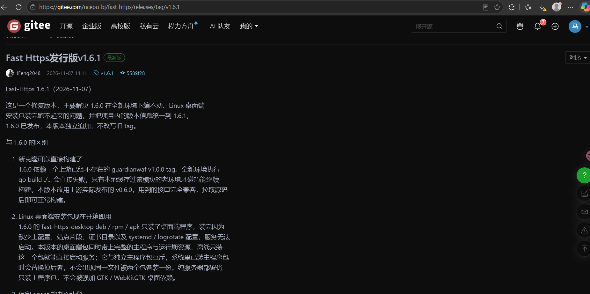
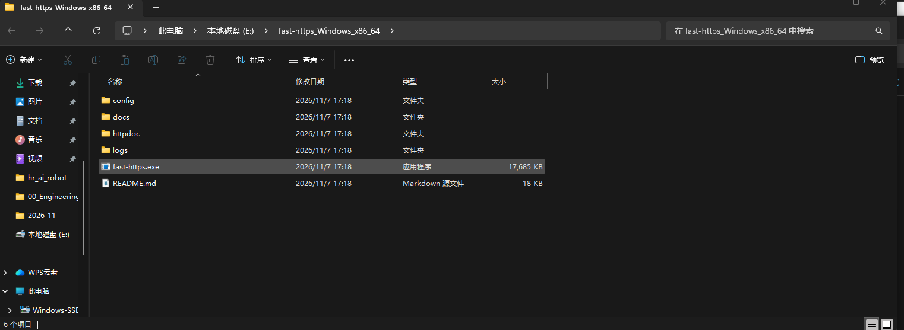
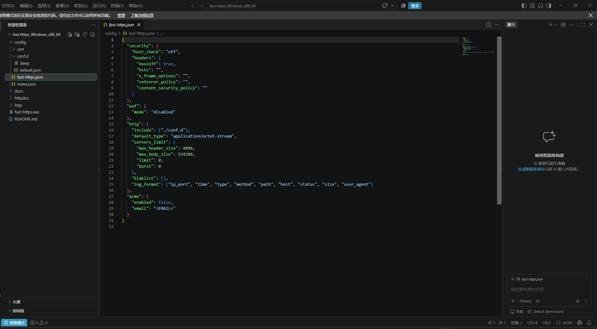
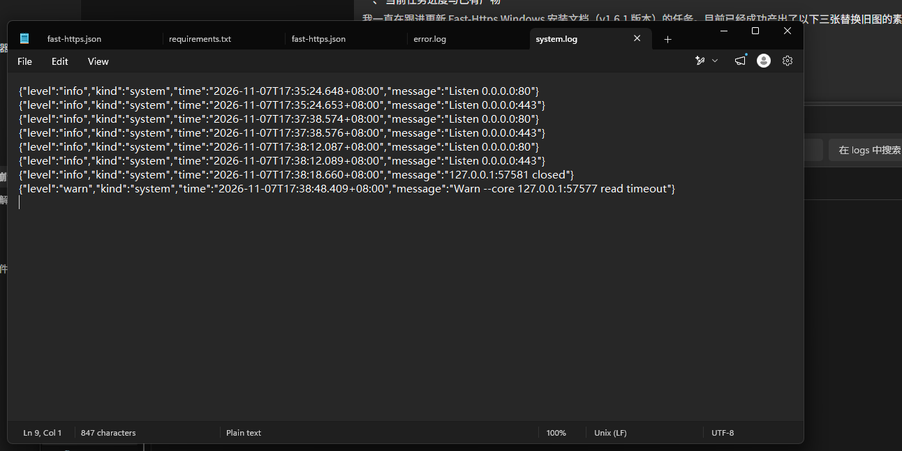
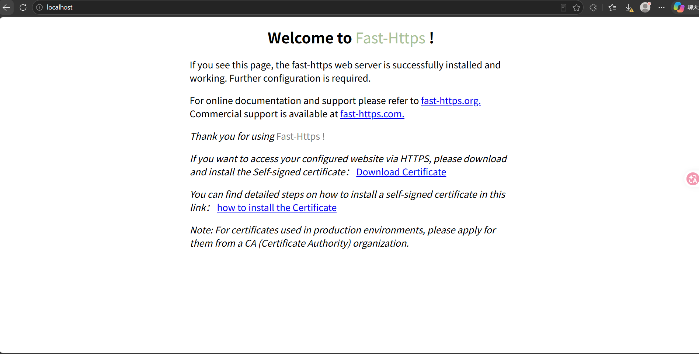
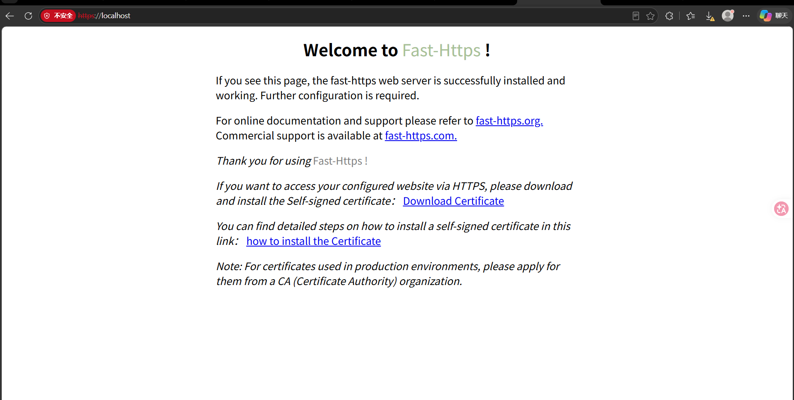

# 压缩包安装

适用于免安装的 `fast-https_Windows_x86_64.zip`：解压即用，无需安装程序，删除整个目录即完成卸载。

从发行页 [gitee.com/ncepu-bj/fast-https/releases](https://gitee.com/ncepu-bj/fast-https/releases) 下载 `fast-https_Windows_x86_64.zip`：



## 1 解压压缩包

解压到本地目录即可，建议路径不含中文和空格，例如 `E:\fast-https_Windows_x86_64`。



<div class="admon">
<svg viewBox="0 0 24 24" fill="none" stroke="currentColor" stroke-width="2"><circle cx="12" cy="12" r="9"/><path d="M12 8v5M12 16h.01"/></svg>
<div>v1.6.1 的发行包里<b>没有 <code>monitor.exe</code></b>，旧教程中「双击 monitor.exe 启动」的步骤已失效。正确的内容是四个文件夹 <code>config</code>、<code>docs</code>、<code>httpdoc</code>、<code>logs</code>，加两个文件 <code>fast-https.exe</code>、<code>README.md</code>；启动方式见第 3 步。压缩包不带图形界面，需要桌面管理端请改用<a href="../安装包安装/">安装包安装</a>。</div>
</div>

## 2 修改默认配置文件

v1.6.1 的配置分成两层：`config/fast-https.json` 只放系统级设置（日志目录、`include`、WAF、ACME），站点配置放在 `config/conf.d/` 下，一个文件一个站点。开箱即用，通常无需修改。

需要调整时，用文本编辑器打开 `config/fast-https.json`：



默认站点 `config/conf.d/default.json` 的内容如下，同时监听 80 与 443，站点根目录为 `./httpdoc/root`：

```json
{
  "listen": [80, "443 ssl h2"],
  "server_name": "localhost",
  "ssl_certificate": "./cert/localhost.pem",
  "ssl_certificate_key": "./cert/localhost-key.pem",
  "location": [
    {
      "url": "/",
      "type": "local",
      "root": "./httpdoc/root",
      "index": ["index.html", "index.htm"]
    }
  ]
}
```

<div class="admon">
<svg viewBox="0 0 24 24" fill="none" stroke="currentColor" stroke-width="2"><circle cx="12" cy="12" r="9"/><path d="M12 8v5M12 16h.01"/></svg>
<div>443 的证书不用预先准备：首次 <code>start</code> 会自动生成自签名证书到 <code>config/cert/</code>。若 80 / 443 已被其他程序占用，把 <code>listen</code> 改成高位端口（例如 <code>[8080, "8443 ssl h2"]</code>），之后访问时需带上端口号。</div>
</div>

## 3 启动服务器

在解压目录的资源管理器地址栏输入 `cmd` 回车，即可在当前目录打开命令提示符，执行：

```bat
.\fast-https.exe start
```

启动成功后，窗口会输出 ASCII 标识与初始化日志，最后停在下面这一行：

```text
======================= Port Listening Start ============================
```



<div class="admon">
<svg viewBox="0 0 24 24" fill="none" stroke="currentColor" stroke-width="2"><circle cx="12" cy="12" r="9"/><path d="M12 8v5M12 16h.01"/></svg>
<div><code>start</code> 是<b>前台运行</b>的，命令不会自动返回提示符，窗口一直停住属于正常现象——这正是服务正在运行的标志。<b>不要关闭这个窗口</b>，关闭即等于停止服务；停止请按 <code>Ctrl+C</code>，或在另一个窗口执行 <code>fast-https.exe stop</code>。</div>
</div>

如果窗口已经关掉、或不确定是否启动成功，用下面任一方式确认：

- 查看 `logs/system.log`，出现这行即代表监听成功：`{"level":"info","kind":"system","message":"Listen 0.0.0.0:80"}`
- 执行 `.\fast-https.exe status`，输出 `fast-https is running, pid <数字>` 即为运行中

<div class="admon">
<svg viewBox="0 0 24 24" fill="none" stroke="currentColor" stroke-width="2"><circle cx="12" cy="12" r="9"/><path d="M12 8v5M12 16h.01"/></svg>
<div>终端没有输出、或窗口一闪而过，<b>并不代表程序崩溃</b>。先执行 <code>status</code> 看真实状态，再检查 <code>logs/error.log</code>——该文件为空说明启动过程没有报错。</div>
</div>

## 4 验证安装

打开浏览器访问：

- `http://localhost/`：看到 `Welcome to Fast-Https !` 即表示 HTTP 正常。

  

- `https://localhost/`：首次访问会提示证书不受信任，因为用的是首次启动自动生成的自签名证书，点击「高级」→「继续前往 localhost」即可。

  

<div class="admon">
<svg viewBox="0 0 24 24" fill="none" stroke="currentColor" stroke-width="2"><circle cx="12" cy="12" r="9"/><path d="M12 8v5M12 16h.01"/></svg>
<div>需要浏览器信任的正式证书时，执行 <code>fast-https.exe acme</code> 接入 Let's Encrypt 等 CA，签发与到期续期由程序自动完成。</div>
</div>

至此，Windows 平台下的压缩包安装完成。
