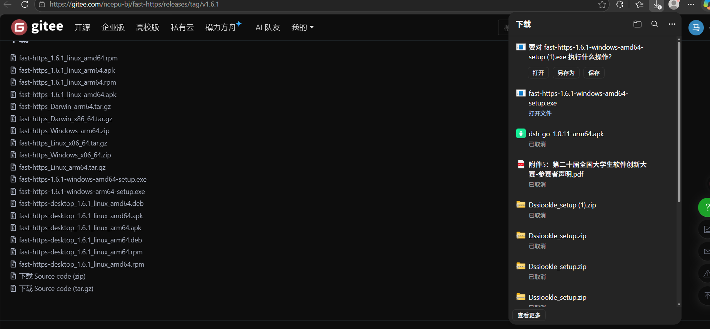
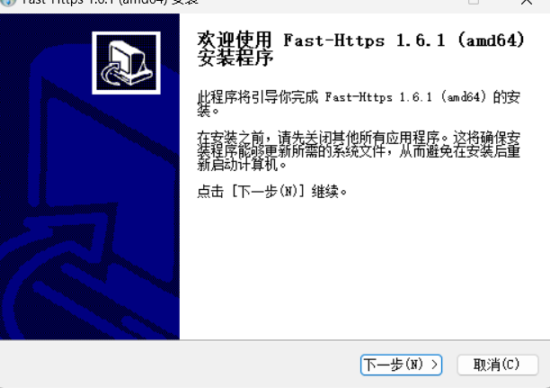
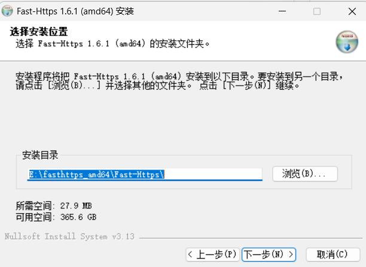
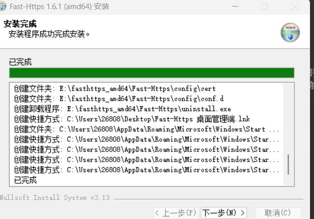
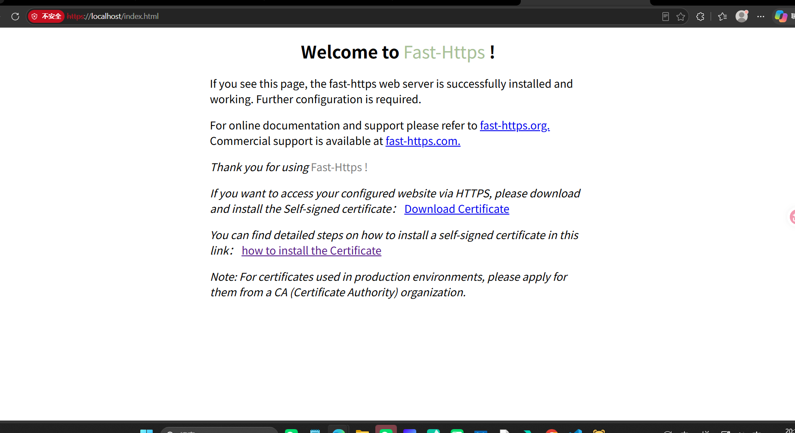
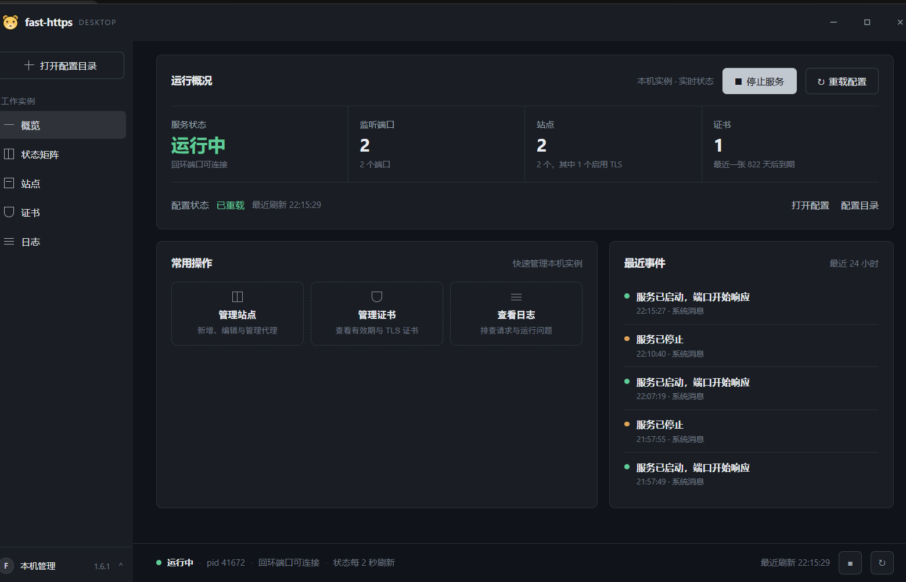
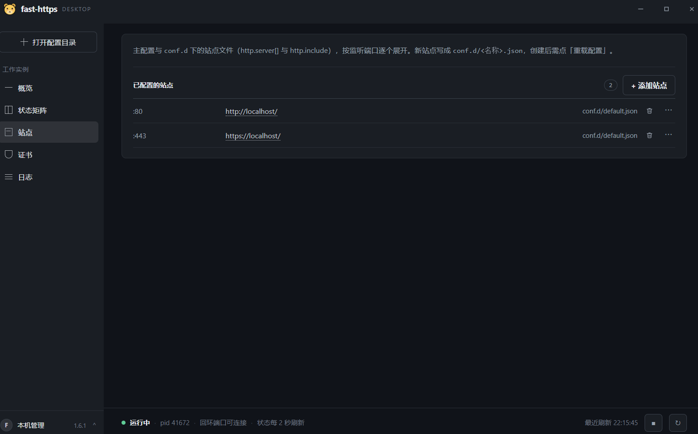
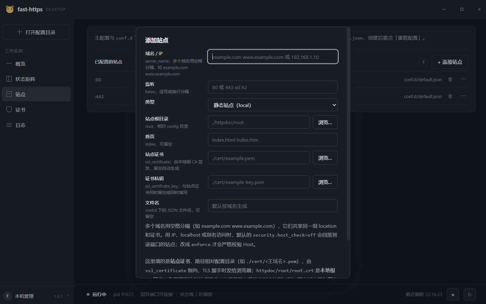

# 安装包安装

从发行页下载 Windows 安装包（`.exe`），双击运行，按向导提示完成安装即可。相比压缩包方式，安装包会把程序写入指定目录、自动创建快捷方式，卸载时走系统的“应用和功能”，并附带图形化桌面管理端。

## 1 下载安装包

打开发行页 [gitee.com/ncepu-bj/fast-https/releases](https://gitee.com/ncepu-bj/fast-https/releases)，在**最上面一条** release 的附件列表里找到安装包。文件名形如：

```text
fast-https-<版本>-windows-amd64-setup.exe      # x64
fast-https-<版本>-windows-arm64-setup.exe      # ARM64
```

`<版本>` 由你下载的那一条 release 决定，文档里不写死，避免版本更新后示例过期。按 `fast-https-<版本>-windows-<架构>-setup.exe` 认即可。不想用安装包的话，同页还有 `fast-https_Windows_x86_64.zip`。



<div class="admon">
<svg viewBox="0 0 24 24" fill="none" stroke="currentColor" stroke-width="2"><circle cx="12" cy="12" r="9"/><path d="M12 8v5M12 16h.01"/></svg>
<div>浏览器提示「此文件不常下载，可能不安全」是<b>正常现象</b>：本项目未购买商业代码签名。在下载面板中点击右侧「…」→「保留」，若仍被拦截，再点击「仍然保留」。这是浏览器的启发式拦截，与安装包本身无关。</div>
</div>

## 2 运行安装向导

双击下载好的 `setup.exe`，启动安装程序。若弹出用户账户控制（UAC）提示，请选择「是」。



## 3 选择安装目录

点击「浏览」按需修改安装路径，建议路径不含中文和空格。



## 4 完成安装

等待文件写入完成，点击「下一步」结束向导。



安装过程会创建桌面快捷方式「Fast-Https 桌面管理端」、开始菜单项，以及卸载程序 `uninstall.exe`。

## 5 启动与验证

### 5.1 启动管理端

安装完成后，从开始菜单或桌面快捷方式启动 **Fast-Https 桌面管理端**。此时服务状态默认为「已停止」，界面底部显示 `pid —`。



### 5.2 启动服务

点击界面右上角的「启动服务」按钮。当服务状态变为绿色的「运行中」，且下方提示「回环端口可连接」时，表示服务已成功启动。此时按钮变为「停止服务」，底部会显示进程 `pid`。



### 5.3 查看站点列表

在左侧菜单点击「站点」，可以查看当前已配置的站点信息。默认已包含一个监听 80 与 443 端口的 `localhost` 站点，两者共用同一份配置 `conf.d/default.json`。



### 5.4 添加站点

点击右上角的「添加站点」按钮，可以配置新的域名 / IP、监听端口、站点根目录以及 SSL 证书等信息，保存后会在 `conf.d/` 下生成对应的 JSON 文件。



### 5.5 浏览器访问验证

打开浏览器访问 `https://localhost/`，能看到 `Welcome to Fast-Https !` 默认页面，即表示安装与启动完全成功。


<div class="admon">
<svg viewBox="0 0 24 24" fill="none" stroke="currentColor" stroke-width="2"><circle cx="12" cy="12" r="9"/><path d="M12 8v5M12 16h.01"/></svg>
<div>443 用的是首次启动自动生成的自签名证书，浏览器会提示「不安全」，点击「高级 → 继续前往 localhost」即可，用 <code>http://localhost/</code> 访问则不会出现该提示。</div>
</div>

<div class="admon">
<svg viewBox="0 0 24 24" fill="none" stroke="currentColor" stroke-width="2"><circle cx="12" cy="12" r="9"/><path d="M12 8v5M12 16h.01"/></svg>
<div>默认端口是 <b>80 和 443</b>，请直接用 <code>http://localhost/</code> 或 <code>https://localhost/</code>，<b>不要加 <code>:8080</code></b>——旧文档里的 <code>https://localhost:8080/index.html</code> 是错误端口，会报「无法访问此网站」。若 80 / 443 已被占用，在第 5.4 步添加站点时改用高位端口即可。</div>
</div>
